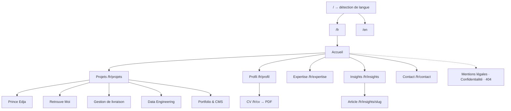
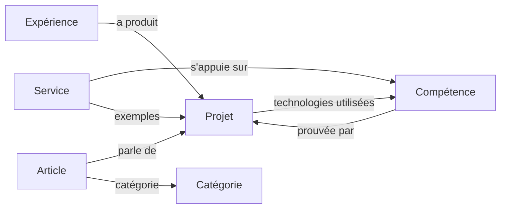

# Étape 6 — Architecture du portfolio

> Livrable du **Prompt 06**. Plan du site, rôle de chaque page et section, liens, bilinguisme.
> S'appuie sur le positionnement validé ([03-positionnement.md](03-positionnement.md)), la maquette validée ([04b-index-studio.html](04b-index-studio.html)) et le design system ([design-system/](design-system/project/README.md)).
> Aucun texte définitif ici : la rédaction est l'étape suivante (Prompt 07).

---

## 1. Décisions principales

| # | Décision | Pourquoi |
|---|---|---|
| D1 | **Site multi-pages**, avec une page d'accueil qui résume tout et renvoie vers des pages complètes. | Une seule page avec 10 sections serait trop longue (les références font 4 500 à 8 400 px). Les pages dédiées sont mieux référencées et partageables (un recruteur peut envoyer le lien d'une étude de cas). |
| D2 | **Fusion « À propos » + « Expérience et formation » en une page `/profil`.** | Avec une expérience et une formation, deux pages seraient trop minces. Un recruteur trouve tout au même endroit : qui tu es, ta méthode, ton parcours, ton CV. *(Alternative : deux pages séparées, comme le prévoyait le Prompt 10.)* |
| D3 | **Fusion « Expertise » + « Services » en une page `/expertise`.** | Les services découlent des compétences. Le client voit ce que tu sais faire *et* ce que tu proposes, avec les niveaux honnêtes (pratiqué / formation / exploration). |
| D4 | **Navigation à 5 entrées : Projets · Profil · Expertise · Insights · Contact.** | Cinq liens tiennent dans la pilule de navigation validée. Chaque lien mène à une page, jamais à une ancre, pour un comportement prévisible. |
| D5 | **Une section n'apparaît que si elle a du contenu publié.** | Exemple : la section Insights de l'accueil reste masquée tant qu'aucun article n'est publié. Aucune section vide, aucun faux contenu. |
| D6 | **URL préfixées par la langue** (`/fr/…`, `/en/…`) avec des chemins traduits. | Meilleur référencement dans les deux langues (balises `hreflang`), liens partageables dans la bonne langue. |

---

## 2. Plan du site

### Tableau des URL

| Page | FR | EN | Indexée |
|---|---|---|---|
| Accueil | `/fr` | `/en` | oui |
| Projets | `/fr/projets` | `/en/projects` | oui |
| Étude de cas | `/fr/projets/{slug-fr}` | `/en/projects/{slug-en}` | oui |
| Profil | `/fr/profil` | `/en/profile` | oui |
| Expertise | `/fr/expertise` | `/en/expertise` | oui |
| Insights | `/fr/insights` | `/en/insights` | oui |
| Article | `/fr/insights/{slug-fr}` | `/en/insights/{slug-en}` | oui |
| Contact | `/fr/contact` | `/en/contact` | oui |
| CV | `/fr/cv` | `/en/cv` | non (redirige vers le PDF) |
| Mentions légales | `/fr/mentions-legales` | `/en/legal-notice` | non |
| Confidentialité | `/fr/confidentialite` | `/en/privacy` | non |
| 404 | page bilingue | | non |
| Admin | `/admin` (application séparée) | | non, protégée |

**Slugs des études de cas** (modifiables dans l'admin) :

| Projet | FR | EN |
|---|---|---|
| Prince Edja | `prince-edja` | `prince-edja` |
| Retrouve Moi | `retrouve-moi` | `retrouve-moi` |
| Gestion de livraison | `gestion-de-livraison` | `delivery-management` |
| Data Engineering | `data-engineering` | `data-engineering` |
| Portfolio & CMS | `portfolio-cms` | `portfolio-cms` |

---

## 3. Page d'accueil

### Ordre des sections et raison

Le parcours suit la question que se pose chaque visiteur : *qui ?* → *preuve* → *compétences* → *offre* → *crédibilité* → *méthode* → *réflexion* → *contact*.

| # | Section | Objectif | Contenu affiché | Interactions | Lien vers | Source (admin) |
|---|---|---|---|---|---|---|
| 1 | **Hero** | Dire qui tu es en 5 secondes. | Ligne d'enregistrement, nom contour/plein, titre, accroche, phrase de valeur, 2 boutons (Projets, CV), pastilles de faits, pile portrait, badge rotatif. | Pile portrait (clic, glisser, flèches), boutons. | Projets, CV | Paramètres, Textes > Hero, Médias |
| 2 | **Ruban technologies** | Montrer la stack réelle d'un coup d'œil. | Icônes des technologies utilisées en projet. | Défilement, pause au survol, nom au survol. | — | Compétences (case « ruban ») |
| 3 | **/PROJETS** | La preuve, en premier. | Les projets mis en avant (5 au lancement) en fiches. | Barre de requête, filtres par domaine, carte cliquable. | Liste Projets, Études de cas | Projets (publiés, ordre, « mis en avant ») |
| 4 | **/PROFIL** | Qui tu es, et ce que tu sais vraiment faire. | 3 à 4 phrases de présentation, 5 domaines avec leur niveau (pratiqué / formation / exploration). | Lien « Lire le profil ». | Profil, Expertise | Textes > À propos, Compétences |
| 5 | **/SERVICES** | Ce que tu proposes aux clients. | 4 services en accordéon. | Accordéon. | Expertise | Textes > Services |
| 6 | **Bandeau « Et votre projet ? »** | Transformer l'intérêt d'un client en contact. | Titre + 6 tuiles de type de projet. | Sélection multiple → Contact pré-rempli. | Contact | Fixe (libellés traduits) |
| 7 | **/PARCOURS** | Crédibilité pour les recruteurs. | Expérience (Smart Innovation 7) et formation (M2 SIGL ESATIC), certifications s'il y en a. | Lien « Parcours complet », bouton CV. | Profil, CV | Expériences, Formations |
| 8 | **/MÉTHODE** | Montrer comment tu travailles. | 4 à 5 étapes réelles de ta façon de travailler (vraie séquence, donc numérotée). | Aucune (lecture). | Profil | Textes > Méthode |
| 9 | **/INSIGHTS** | Montrer ta réflexion. **Masquée si aucun article publié.** | Les 3 derniers articles. | Cartes cliquables. | Insights, Articles | Articles (publiés) |
| 10 | **Footer** | Dernière action. | Phrase d'appel, bouton rond, liens (LinkedIn, GitHub, email, CV), signature, mentions. | Bouton magnétique, copie de l'email. | Contact, liens externes | Paramètres, Textes > Footer |

**Ce qui n'est pas sur l'accueil :** le détail des compétences et des technologies (→ `/expertise`), les missions détaillées (→ `/profil`), les articles complets.

---

## 4. Pages secondaires

### 4.1 Projets — `/fr/projets`
- **Objectif :** voir tous les projets et trouver le bon rapidement.
- **Contenu :** titre /PROJETS + compteur, barre de requête, filtres par domaine (web, mobile, data, cloud, ia), grille de fiches (2 colonnes, 1 sur mobile).
- **Comportement :** filtre et recherche s'additionnent, résultat annoncé (« 2 / 5 enregistrements »), état vide explicite. Les filtres sont reflétés dans l'URL (`?domaine=mobile`) pour qu'un lien filtré soit partageable. Ces URL filtrées ne sont pas indexées.

### 4.2 Étude de cas — `/fr/projets/{slug}`
Structure commune aux 5 projets (système de données réutilisable, une seule mise en page) :

| Bloc | Contenu | Obligatoire |
|---|---|---|
| En-tête | Identifiant (PRJ-02), type, nom en grand, accroche | oui |
| Fiche | Champs : rôle, période, contexte (client / stage / académique / personnel), stack, liens (démo, GitHub) | rôle, contexte, stack |
| Image principale | Capture réelle 16:10 | non (masquée si absente) |
| Contexte | Pourquoi ce projet existe | oui |
| Problématique | Le problème à résoudre | oui |
| Objectifs | 2 à 5 objectifs | oui |
| Approche et solution | Ce qui a été construit et comment | oui |
| Architecture | Schéma (image ou diagramme) + explication | non |
| Technologies | Liste avec rôle de chaque techno dans le projet | oui |
| Difficultés | Problèmes rencontrés et solutions | non |
| Résultats | **Uniquement des faits vérifiables.** Masqué si vide. | non |
| Galerie | Captures réelles, ouverture plein écran | non |
| Projet suivant | Grand bloc vers le projet suivant (boucle) | oui |

- **Navigation dans la page :** sommaire latéral collant sur ordinateur (suit la lecture), pourcentage de lecture en bas à droite, retour à la liste.
- **Particularités :**
  - *Prince Edja* : badge « projet client · réalisé seul ».
  - *Gestion de livraison* : lien vers l'expérience Smart Innovation 7 sur `/profil`.
  - *Data Engineering* : la section Architecture peut montrer le pipeline de traitement (exploration → nettoyage → transformation → qualité).
  - *Portfolio & CMS* : écrit au fil du projet, à partir de ce que nous construisons réellement (architecture, sécurité, déploiement Vercel).

### 4.3 Profil — `/fr/profil`
- **Objectif :** tout ce qu'un recruteur veut savoir, sur une page.
- **Contenu :** présentation complète, vision professionnelle, méthode de travail (étapes détaillées), parcours (expériences avec missions réelles, formations, certifications), langues, disponibilité et mode de travail (télétravail international, fuseau horaire), bouton CV.
- **Liens :** vers les projets liés à chaque expérience, vers Expertise, vers Contact.

### 4.4 Expertise — `/fr/expertise`
- **Objectif :** montrer ce que tu sais faire et ce que tu proposes, honnêtement.
- **Contenu :**
  1. Les 5 domaines (Software Engineering, Web & Mobile, Data Engineering, Cloud & DevOps, IA générative & automatisation), chacun avec une description et ses technologies.
  2. La matrice des compétences sur 3 niveaux : **pratiqué en projet**, **formation et pratique encadrée**, **en exploration**. Chaque compétence pratiquée renvoie aux projets qui la prouvent.
  3. Les services : problème résolu, livrables types, projets liés.
  4. Bandeau « Et votre projet ? ».
- **Interactions :** filtre par niveau ou par domaine, survol d'une compétence → projets liés mis en avant.

### 4.5 Insights — `/fr/insights`
- **Objectif :** montrer ta réflexion technique et attirer du trafic.
- **Contenu :** titre /INSIGHTS, barre de requête, filtres par catégorie, liste d'articles (carte : catégorie, titre, chapeau, date, temps de lecture, langue).
- **Catégories proposées** (finalisées à l'étape rédaction) : Data Engineering · Web & Mobile · IA & automatisation · Cloud · Carnet de projet.
- **Recherche :** côté navigateur tant qu'il y a moins d'une cinquantaine d'articles (instantanée, sans serveur). Recherche serveur ensuite si nécessaire.
- **État vide :** tant qu'aucun article n'est publié, la page affiche « Premiers articles en préparation » et n'est pas dans la navigation. *(Alternative : lien visible avec badge « bientôt », comme dans la maquette.)*

### 4.6 Article — `/fr/insights/{slug}`
- **En-tête :** catégorie, titre, chapeau, date de publication, date de mise à jour, temps de lecture (calculé automatiquement), langue disponible.
- **Corps :** texte riche (titres, listes, citations, code avec coloration, images, schémas).
- **Sommaire :** affiché automatiquement si l'article a au moins 3 intertitres. Collant sur ordinateur, repliable sur mobile.
- **Fin d'article :** partage (copier le lien, LinkedIn, X), 3 articles associés (même catégorie, puis les plus récents), lien Contact.
- **Lecture :** pourcentage de progression.

### 4.7 Contact — `/fr/contact`
- **Objectif :** un contact sans friction, adapté à chaque public.
- **Contenu :**
  - Choix du profil : **Recruteur**, **Client**, **Autre**. Le formulaire s'adapte : un recruteur voit « entreprise / poste », un client voit « types de projet » (pré-remplis depuis le bandeau) et « délai souhaité ».
  - Champs communs : nom, email, message, consentement au traitement des données.
  - À côté : email en texte copiable, LinkedIn, GitHub, CV, disponibilité, fuseau horaire.
- **Après envoi :** message de confirmation à l'écran. L'envoi est traité par le backend (stockage + notification), avec une protection anti-spam (champ piège + limitation du nombre d'envois).

### 4.8 Pages techniques
- **CV** : `/fr/cv` et `/en/cv` redirigent vers le PDF actif choisi dans l'admin (un CV par langue si tu en fournis deux).
- **Mentions légales et Confidentialité** : obligatoires dès qu'un formulaire collecte des données personnelles.
- **404** : bilingue, dans l'identité (« record introuvable »), avec liens vers Accueil et Projets.

---

## 5. Éléments communs à toutes les pages

| Élément | Comportement |
|---|---|
| Barre de navigation | Logo · pilule à 5 liens · statut · langue. Point jaune sur la page en cours. Se cache en descendant. Menu rond sur mobile. |
| Footer | Identique partout (sauf sur Contact, où le bouton rond est remplacé par l'email). |
| Grain de papier | Fixe, sur toutes les pages. |
| Curseur à étiquette | Sur ordinateur uniquement, sur les éléments interactifs désignés. |
| Introduction | Une seule fois par session, à la première page visitée, moins de 1,5 s, peut être passée. |
| Transitions de page | Définies à l'étape motion design. |
| Pourcentage de lecture | Études de cas et articles uniquement. |
| Métadonnées SEO | Titre, description, image de partage (générée par page), `hreflang` FR/EN. |

---

## 6. Liens entre les contenus

Ces liens sont gérés dans l'admin. Ils permettent par exemple qu'une compétence affichée « pratiquée » montre toujours les projets qui le prouvent.

---

## 7. Bilinguisme

| Sujet | Fonctionnement |
|---|---|
| **Première visite** | `/` détecte la langue du navigateur : français → `/fr`, toute autre langue → `/en` (cible internationale). |
| **Changement de langue** | Le bouton FR/EN ouvre **la même page** dans l'autre langue (correspondance des slugs gérée par la base), pas l'accueil. Transition : révélation circulaire depuis le bouton. |
| **Mémorisation** | Choix enregistré dans un cookie `lang` (1 an). Il prime sur la détection automatique. |
| **Contenus traduits** | Chaque contenu a une version FR et une version EN, saisies séparément dans l'admin. Une modification en français n'écrase jamais l'anglais. |
| **Publication** | Textes du site et projets : **les deux langues obligatoires** avant publication (cohérence). Articles : **publication possible dans une seule langue** ; ils n'apparaissent alors que dans la liste de cette langue. |
| **Article sans traduction** | Le bouton de langue mène à la liste Insights de l'autre langue, avec un message « Cet article n'existe qu'en français ». |
| **SEO** | Balises `hreflang="fr"`, `hreflang="en"` et `x-default` (→ EN) sur chaque page ; sitemap avec les deux versions. |
| **Formats** | Dates localisées (« 6 nov. 2026 » / « Nov 6, 2026 »). |

---

## 8. Récapitulatif des contenus à saisir dans l'admin

| Module admin | Alimente |
|---|---|
| Paramètres | Nom, photo, email, réseaux, CV (FR/EN), disponibilité, fuseau horaire, ville |
| Textes du site | Hero, Profil, Méthode, Services, Contact, Footer, 404 |
| Projets | 5 études de cas + ordre + « mis en avant » |
| Compétences | Domaines, niveaux, technologies, ruban, liens vers projets |
| Expériences / Formations / Certifications | /PARCOURS et Profil |
| Articles + Catégories | Insights |
| Médias | Portrait, captures, schémas, images de partage |
| Messages | Demandes reçues via Contact |

---

## 9. À valider

| # | Question | Ma recommandation |
|---|---|---|
| 1 | Fusionner « À propos » et « Expérience et formation » dans `/profil` ? | Oui |
| 2 | Fusionner « Expertise » et « Services » dans `/expertise` ? | Oui |
| 3 | Navigation : Projets · Profil · Expertise · Insights · Contact ? | Oui |
| 4 | Langue par défaut pour les visiteurs ni francophones ni anglophones : anglais ? | Oui |
| 5 | Articles publiables dans une seule langue ? | Oui |
| 6 | Insights masqué de la navigation tant qu'il n'y a aucun article ? | Oui |
| 7 | Un CV par langue ? | Si tu en as deux, oui |
