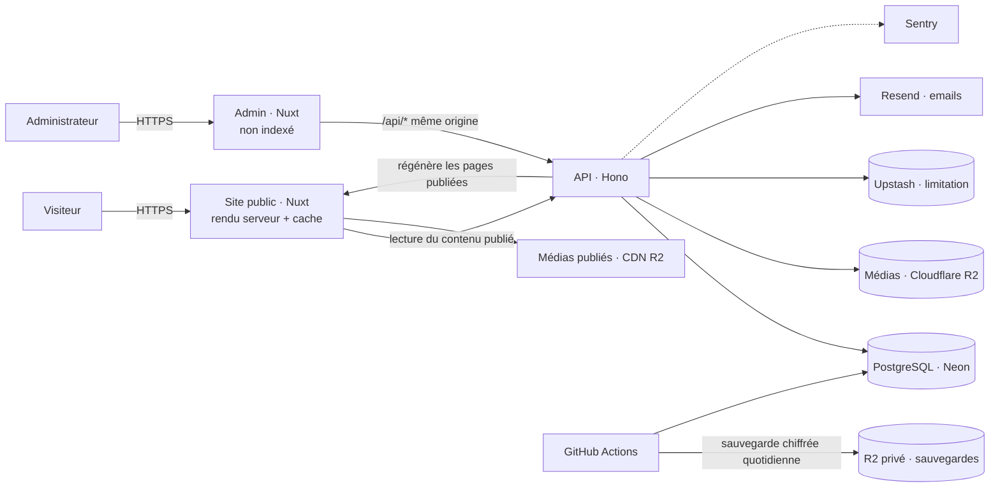

# Étape 11 — Architecture technique

> Livrable du **Prompt 11**. Choix techniques justifiés pour le site public, l'API, la base de données, les médias, l'espace d'administration et le déploiement.
> Prend en compte les exigences de [admin_portfolio.md](../admin_portfolio.md) : backend réel, séparation site / admin / API, sécurité, journalisation, sauvegardes.
> **Rien n'est créé avant validation.** Les versions exactes des bibliothèques seront vérifiées à l'initialisation (Prompt 12).

---

## 1. Environnement constaté (6 novembre 2026)

| Outil | Version | Conséquence |
|---|---|---|
| Ubuntu (WSL) | 24.04 LTS | Environnement de développement principal |
| Node.js | 24.18 | Compatible Vercel. Le projet sera fixé sur Node 24 dans `package.json` et sur Vercel |
| npm | 11.16 | — |
| pnpm | absent, activable via corepack | Gestionnaire retenu (monorepo, rapide, économe en disque) |
| Docker | 29.1 | PostgreSQL local pour le développement, identique à la production |
| Git | 2.43 | Dépôt Git à créer (le dossier n'en est pas un) |
| Vercel CLI | absent | À installer pour lier les projets (ou passer par l'interface Vercel) |
| Mémoire WSL | 3,7 Go | Lancer une seule application à la fois en développement, ou augmenter la mémoire allouée à WSL |

---

## 2. Besoins qui guident les choix

1. **Rendu serveur** du site public : référencement, partage de liens, contenu visible sans JavaScript (règle de l'étape motion).
2. **Contenu dynamique** venant d'une base de données, **publié par l'admin** et visible immédiatement sur le site, sans republier le code.
3. **Bilingue** avec URL traduites et `hreflang`.
4. **Séparation** site public / admin / API / base / médias, exigée par le cahier des charges admin.
5. **Sécurité réelle** : sessions en cookies HttpOnly, rôles, protection CSRF et XSS, limitation des tentatives, journal d'activité, sauvegardes.
6. **Animations exigeantes** (GSAP, défilement doux, transitions de page).
7. **Hébergement Vercel**, coût nul ou très faible au départ.
8. **Maintenable par toi seul**, dans des technologies que tu maîtrises ou que tu veux montrer.

---

## 3. Choix du framework — la décision principale

| Critère | **Nuxt** (Vue 3) | Next.js (React) | Astro |
|---|---|---|---|
| Rendu serveur, pages statiques régénérées | ✅ | ✅ | ✅ |
| Tu le connais déjà | ✅ **Vue.js utilisé en stage** | ❌ React n'apparaît pas dans tes projets | ❌ |
| Bilingue avec URL traduites | ✅ module `@nuxtjs/i18n`, très complet | ✅ (à assembler soi-même) | ✅ |
| Transitions de page (View Transitions) | ✅ intégrées (option expérimentale) | ⚠️ expérimental | ✅ excellent |
| Admin riche (formulaires, éditeur) dans le même langage | ✅ | ✅ | ⚠️ nécessite un autre framework pour l'admin |
| Déploiement Vercel | ✅ | ✅ (natif) | ✅ |
| Écosystème | Large | Le plus large | Plus orienté contenu |
| Valeur pour ton portfolio | Montre une maîtrise approfondie de **ta** stack | Montre une nouvelle compétence | — |

### Recommandation : **Nuxt (Vue 3 + TypeScript)**

- Tu as déjà utilisé Vue.js en entreprise : tu pourras **maintenir et expliquer chaque ligne** en entretien. C'est aussi le meilleur argument pour l'étude de cas « Portfolio & CMS ».
- Nuxt couvre tous les besoins : rendu serveur, régénération des pages à la publication, i18n mature, View Transitions, optimisation des images, SEO.
- Le même langage pour le site et l'admin réduit la charge de maintenance.

**Alternative : Next.js.** À choisir si tu veux ajouter React à ton profil (très demandé par les recruteurs). Contrepartie : apprentissage en plus, i18n à assembler. Le reste de l'architecture ne change pas.

---

## 4. Stack retenue

| Couche | Choix | Pourquoi |
|---|---|---|
| Langage | **TypeScript** partout | Contrats de données vérifiés entre le site, l'admin et l'API |
| Site public | **Nuxt** (rendu serveur + régénération à la demande) | Voir §3 |
| Espace admin | **Nuxt** (application à part, rendue côté navigateur, non indexée) | Même langage, séparé du site public |
| API | **Hono** (TypeScript) + **Zod** + génération **OpenAPI** | Légère, rapide, conçue pour les fonctions serveur Vercel. La validation Zod produit automatiquement la documentation OpenAPI demandée par le cahier des charges |
| Base de données | **PostgreSQL** hébergé chez **Neon** | Relationnel : traductions, relations projet ↔ compétence, historique des versions, transactions pour une publication cohérente. Neon s'intègre à Vercel, crée une base par environnement de prévisualisation et permet la restauration à un instant donné |
| Accès aux données | **Drizzle ORM** + migrations | Proche du SQL, typé, migrations versionnées dans Git |
| Authentification | **Better Auth** (sessions en base) | Sessions dans des cookies HttpOnly/Secure/SameSite, double authentification (TOTP), rôles, révocation des sessions, limitation des tentatives. Évite de réécrire une partie sensible |
| Médias | **Cloudflare R2** (tu le connais) | Compatible S3, pas de frais de sortie. Dépôt privé pour les originaux, accès public seulement aux médias publiés. Envois par URL signée, délivrée par l'API après contrôle des droits |
| Images du site | **Nuxt Image** avec l'optimiseur Vercel | Formats modernes (AVIF/WebP), tailles adaptées, chargement différé |
| Éditeur de contenu (admin) | **TipTap** | Éditeur riche pour études de cas et articles. Stocke une structure JSON (pas de HTML brut), convertie et nettoyée côté serveur : réduit le risque XSS |
| Emails | **Resend** | Notification des messages de contact, alertes de sécurité, réinitialisation du mot de passe |
| Limitation des requêtes | **Upstash Redis** | Compteurs partagés entre fonctions serveur (connexion, contact) |
| Anti-robots (contact) | Champ piège + **Cloudflare Turnstile** | Sans cookie, gratuit |
| Animations | **GSAP** (+ ScrollTrigger, SplitText, Flip) + **Lenis** | Validé à l'étape motion |
| Styles | **CSS natif** + variables du design system + styles par composant Vue | Le design est sur mesure et les tokens sont déjà des variables CSS. Pas besoin de Tailwind |
| Erreurs et surveillance | **Sentry** (site, admin, API) + **Vercel Web Analytics** (sans cookie) + sonde de disponibilité | Indicateurs réellement mesurés, comme l'exige le cahier des charges |
| Tests | **Vitest** (unitaires), **Playwright** (parcours, visuels), **axe** (accessibilité), **Lighthouse CI** | |
| Monorepo | **pnpm** + **Turborepo** | Trois applications et des paquets partagés dans un seul dépôt |

**Coût au lancement :** 0 €. Toutes ces offres ont un niveau gratuit suffisant pour un portfolio. Une limite : l'offre gratuite Vercel (Hobby) est réservée à un usage **personnel et non commercial**. Si l'activité freelance passe par le site de façon importante, prévoir l'offre Pro.

---

## 5. Architecture d'ensemble



### Règles qui en découlent

1. **L'admin ne touche jamais la base ni le stockage directement.** Tout passe par l'API, qui vérifie la session, le rôle, la validité des données et journalise l'action.
2. **Le site public ne lit que le contenu publié.** Les brouillons vivent dans d'autres colonnes ou tables : une modification non publiée ne peut pas apparaître sur le site.
3. **Publier régénère les pages concernées.** À la publication, l'API demande à Vercel de reconstruire uniquement les pages touchées (accueil, liste, page du projet, dans les deux langues). Le changement est visible en quelques secondes, sans redéployer.
4. **L'admin appelle l'API sur sa propre origine** (`/api/*` redirigé vers le projet API). Raison : les domaines `*.vercel.app` sont considérés comme des sites distincts par les navigateurs, donc un cookie de session posé par un autre domaine serait bloqué. Avec un domaine personnalisé plus tard, cette règle reste valable et plus simple.
5. **Une publication est une transaction** : soit tout est enregistré (contenu, version, journal), soit rien. La régénération du site est relancée automatiquement si elle échoue.

---

## 6. Organisation du dépôt

```
portfolio/
├── apps/
│   ├── web/                     Site public (Nuxt)
│   │   ├── app/
│   │   │   ├── pages/           Accueil, projets/[slug], profil, expertise, insights/[slug], contact
│   │   │   ├── components/
│   │   │   │   ├── layout/      NavBar, Footer, LangToggle, ThemeToggle, SkipLink
│   │   │   │   ├── sections/    Hero, TechRibbon, ProjectsSection, ServicesAccordion, Band…
│   │   │   │   └── ui/          Button, Badge, Chip, QueryBar, RecordFields, ProjectCard… (design system)
│   │   │   ├── composables/     useContent, useFilters, useReadingProgress…
│   │   │   ├── motion/          tokens, setup, presets, transitions, cursor, intro (étape 8)
│   │   │   └── assets/styles/   tokens.css (généré), base.css
│   │   ├── i18n/locales/        fr.json, en.json (textes d'interface)
│   │   └── nuxt.config.ts
│   ├── admin/                   Espace d'administration (Nuxt, rendu navigateur)
│   │   └── app/pages/           login, dashboard, projets, articles, médias, textes, sécurité…
│   └── api/                     API (Hono)
│       ├── src/routes/          public/, admin/, auth/, health
│       ├── src/middleware/      session, rôles, CSRF, limitation, journal
│       ├── src/services/        publication, médias, régénération, emails, sauvegardes
│       ├── src/db/              schéma Drizzle + migrations
│       └── openapi/             documentation générée
├── packages/
│   ├── shared/                  Schémas Zod, types, constantes (langues, domaines, rôles)
│   └── design-tokens/           tokens.json (source du design system) → tokens.css
├── docs/                        Documents de conception (existants)
├── .github/workflows/           Intégration continue, sauvegardes
├── docker-compose.yml           PostgreSQL local
└── turbo.json, pnpm-workspace.yaml
```

### Organisation des composants (site public)

| Niveau | Rôle | Exemple |
|---|---|---|
| `ui/` | Composants du design system, sans logique métier, sans appel réseau | `Button`, `Badge`, `FilterChips` |
| `sections/` | Assemblent des composants `ui/` et reçoivent des données | `ProjectsSection` reçoit la liste des projets |
| `layout/` | Éléments présents sur toutes les pages | `NavBar`, `Footer` |
| `pages/` | Récupèrent les données (côté serveur) et assemblent les sections | `pages/projets/[slug].vue` |

---

## 7. Gestion des données

### Flux de contenu

| Étape | Où | Ce qui se passe |
|---|---|---|
| 1. Rédaction | Admin | Formulaire validé par les schémas Zod partagés. Enregistrement en **brouillon** via l'API |
| 2. Prévisualisation | Admin → site | Lien de prévisualisation signé et temporaire, qui affiche le brouillon dans le vrai design du site |
| 3. Publication | API | Transaction : copie du brouillon dans la version publiée (par langue), création d'une révision, écriture au journal |
| 4. Mise à jour du site | API → Vercel | Régénération des pages concernées dans les deux langues |
| 5. Lecture | Site public | Pages servies depuis le cache, régénérées seulement à la publication |

### Modèle de données (aperçu)

Le modèle complet sera défini avec l'admin (Prompt 08 du cahier admin). Principes :

- **Une table par type de contenu + une table de traductions** : `project` / `project_translation (locale, slug, titre, …, statut)`, idem pour les articles, textes de pages, compétences, expériences.
- **Statut par langue** : brouillon, en révision, publié, archivé. Une langue peut être publiée sans l'autre pour les articles (décision de l'étape 6).
- **Révisions** : chaque publication crée une copie figée, ce qui permet de comparer et de restaurer.
- **Relations** : projet ↔ compétence, projet ↔ expérience, article ↔ projet, média ↔ contenus qui l'utilisent (empêche de supprimer un média utilisé).
- **Journal d'activité** en ajout seul : le compte de base de données de l'application ne peut ni modifier ni supprimer une ligne du journal.

---

## 8. Traductions

| Type de texte | Où il vit | Qui le modifie |
|---|---|---|
| Textes d'interface (boutons, libellés, erreurs) | `apps/web/i18n/locales/fr.json` et `en.json` | Le code (rare) |
| Contenus éditoriaux (Hero, projets, articles, services…) | Base de données, une ligne par langue | L'admin |
| Slugs d'URL | Base de données (par langue) | L'admin |

- `@nuxtjs/i18n` en mode **préfixe** (`/fr`, `/en`), chemins traduits (`/fr/projets` ↔ `/en/projects`).
- Détection de la langue du navigateur à la première visite, choix mémorisé dans un cookie.
- Le sélecteur de langue utilise la correspondance des slugs fournie par l'API pour ouvrir la même page dans l'autre langue.
- Balises `hreflang` (fr, en, x-default) générées automatiquement.
- L'admin signale les traductions manquantes et bloque la publication d'un projet incomplet dans une langue (décision de l'étape 6).

---

## 9. Animations

- Implémentation conforme à [08-motion.md](08-motion.md) : dossier `motion/` dans le site public.
- GSAP et ses extensions sont **chargés côté navigateur uniquement** (aucun impact sur le rendu serveur).
- Transitions de page : View Transitions de Nuxt, avec un repli en fondu.
- Un **plugin Nuxt** initialise une seule fois Lenis et ScrollTrigger, et expose l'état « animations réduites / pointeur fin / mobile » à tous les composants.

---

## 10. SEO

| Élément | Mise en œuvre |
|---|---|
| Rendu | Pages rendues côté serveur puis mises en cache, HTML complet pour les robots |
| Balises | Titre et description par page (contenus de l'étape 7), modifiables dans l'admin |
| Partage | Images Open Graph générées automatiquement par page (titre + identité visuelle), ou image choisie dans l'admin |
| Langues | `hreflang`, URL traduites, attribut `lang` correct |
| Plan du site | `sitemap.xml` généré à partir des contenus publiés, dans les deux langues |
| `robots.txt` | Site public indexé ; admin, API et prévisualisations exclus (`noindex`) |
| Données structurées | `Person` (profil), `WebSite`, `CreativeWork` (projets), `BlogPosting` (articles), `BreadcrumbList` |
| Performance | Objectif Lighthouse ≥ 95 sur les 4 critères, mesuré dans l'intégration continue |

---

## 11. Sécurité (résumé)

Le détail viendra avec le cahier admin (Prompt 04 admin). Bases posées dès maintenant :

- Sessions en **cookies HttpOnly, Secure, SameSite=Lax**, stockées en base, révocables, avec expiration.
- **Mots de passe** hachés (Argon2id ou scrypt), **double authentification** TOTP pour l'administrateur.
- **CSRF** : cookies SameSite + vérification de l'origine + jeton pour les requêtes qui modifient des données.
- **XSS** : contenus riches stockés en JSON et nettoyés au rendu ; politique de sécurité du contenu (CSP) stricte.
- **Validation** de toutes les entrées côté serveur (Zod). Requêtes SQL paramétrées (Drizzle).
- **Limitation** des tentatives de connexion et des envois de contact.
- **Uploads** : types MIME vérifiés sur le contenu réel, tailles limitées, noms de fichiers générés, dépôt privé.
- **Secrets** uniquement dans les variables d'environnement Vercel, jamais dans le dépôt.
- **En-têtes HTTP** : HSTS, CSP, X-Content-Type-Options, Referrer-Policy, Permissions-Policy, protection contre l'intégration en iframe.

---

## 12. Déploiement

| Élément | Choix |
|---|---|
| Code source | Dépôt GitHub (privé ou public, à décider) |
| Projets Vercel | 3 projets liés au même dépôt : `web`, `admin`, `api`. Chacun ne se reconstruit que si son dossier ou un paquet partagé change |
| Environnements | **Production** (branche principale) · **Prévisualisation** (chaque branche ou pull request, avec sa propre base Neon) · **Local** (Docker) |
| Domaines | `*.vercel.app` pour l'instant ; domaine personnalisé plus tard (la configuration le prévoit) |
| Variables d'environnement | Gérées dans Vercel, par environnement ; un fichier `.env.example` documente la liste sans valeurs |
| Base de données | Migrations appliquées automatiquement au déploiement de l'API, jamais à la main |
| Intégration continue | GitHub Actions : vérification du typage, tests, accessibilité et Lighthouse sur chaque pull request |
| Sauvegardes | Restauration à un instant donné (Neon) + export quotidien chiffré vers un dépôt R2 privé (GitHub Actions). **Restauration testée** avant la mise en production |
| Mise en ligne | Aucune publication ni modification des réglages d'hébergement sans ton accord explicite |

---

## 13. Ordre de développement proposé

Le cahier admin exige que le contenu vienne de l'admin. Pour ne pas bloquer le site public, on avance en parallèle avec des **données de départ** (les textes validés à l'étape 7) :

1. **Initialisation** (Prompt 12) : monorepo, design tokens, base locale, schéma minimal, données de départ, projets Vercel non publiés.
2. **Site public** (Prompts 13 à 16) branché sur l'API en lecture, avec les données de départ.
3. **Admin et sécurité** (cahier admin, Prompts 01 à 10), qui remplace progressivement les données de départ par tes vraies données.
4. **Optimisation, tests, mise en production** (Prompts 17 à 20).

---

## 14. À valider

| # | Question | Ma recommandation |
|---|---|---|
| 1 | Framework : **Nuxt** (ta stack Vue) ou Next.js (React, nouvelle compétence) ? | Nuxt |
| 2 | API séparée (**Hono**) plutôt que dans le même projet que le site ? | Oui (séparation exigée par le cahier admin) |
| 3 | **PostgreSQL (Neon)** plutôt que MongoDB, que tu connais ? | Oui (relations, traductions, transactions, historique) |
| 4 | **Cloudflare R2** pour les médias ? | Oui |
| 5 | Dépôt GitHub **public** (vitrine de ton code) ou **privé** ? | Public, sans aucun secret dedans |
| 6 | Ordre : site public d'abord avec données de départ, puis admin ? | Oui |
