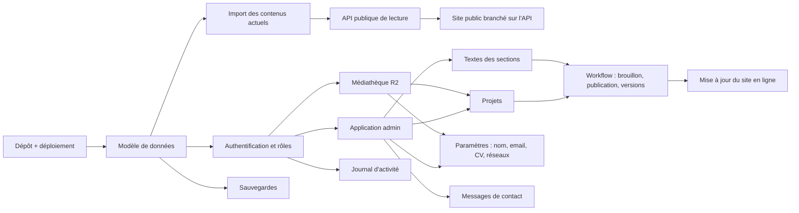

# Admin · Étape 01 — Audit du site public et de l'existant

> Livrable du **Prompt 01** de [admin_portfolio.md](../../admin_portfolio.md). Audit réalisé le 2026-11-07 sur le code réel du dépôt (pas sur les maquettes).
> Aucune architecture définitive n'est proposée ici : elle viendra aux étapes 02 à 08, après ta validation.

## Résumé

- Le **site public est construit** : 9 pages, bilingue FR/EN, design « Index Studio », optimisé (étape 17). Mais **tout son contenu éditorial est écrit en dur dans le code**, dans 4 fichiers de « données de départ » (`apps/web/app/content/*.ts`). Ces fichiers ont déjà la forme que l'API devra renvoyer, donc le passage à la base ne demandera pas de refaire les composants.
- L'**API existe** mais ne fait qu'une chose : recevoir le formulaire de contact et l'enregistrer en base. Elle n'a ni contenu, ni authentification, ni médias.
- L'**espace admin n'existe pas** (aucun dossier `apps/admin`).
- Le projet **n'est ni versionné (aucun commit), ni sur GitHub, ni déployé**. C'est un risque de perte de travail : je recommande un premier commit et un dépôt GitHub avant de commencer l'admin.
- Écarts avec le cahier des charges : la section **Insights a été retirée** du site public par toi, et il y a **5 projets** (le portfolio lui-même est le 5ᵉ), pas 4.

---

## 1. Inventaire du site public

### Pages

| Page | URL FR / EN | Sections | État |
|---|---|---|---|
| Accueil | `/fr` · `/en` | Hero, ruban technologies, projets (filtres + recherche), profil court, services (accordéon), bandeau « Vous avez un projet ? », parcours, méthode en 5 étapes | Fait |
| Projets | `/fr/projets` · `/en/projects` | Titre, filtres par domaine, recherche, grille de cartes, bandeau projet | Fait |
| Étude de cas | `/fr/projets/[slug]` · `/en/projects/[slug]` | En-tête (badges, accroche, faits, liens), image principale, sommaire, contexte, problématique, objectifs, solution, architecture, technologies, difficultés, résultats, galerie, projet suivant | Fait (contenus partiels) |
| Profil | `/fr/profil` · `/en/profile` | Présentation longue + photo, faits pratiques, vision, méthode, parcours détaillé (expériences, formation) | Fait |
| Expertise | `/fr/expertise` · `/en/expertise` | Domaines, matrice des compétences (pratiqué / étudié / en exploration), services détaillés, bandeau projet | Fait |
| Contact | `/fr/contact` · `/en/contact` | Formulaire (profil, champs, types de projet, consentement), encart liens et CV | Fait, **envoi réel** vers l'API |
| Mentions légales | `/fr/mentions-legales` · `/en/legal-notice` | — | **Page provisoire** (« en construction ») |
| Confidentialité | `/fr/confidentialite` · `/en/privacy` | — | **Page provisoire** |
| 404 | toute URL inconnue | Message, liens retour | Fait |

Éléments communs : barre de navigation (ancres de l'accueil + Contact), choix de langue, thème clair/sombre, intro de première visite, curseur, transitions de page, pied de page (signature géante, liens, mentions).

### Contenus par nature

| Nature | Où c'est aujourd'hui | Détail |
|---|---|---|
| Textes éditoriaux | `content/home.ts`, `profile.ts`, `projects.ts`, `tech.ts` | Hero, présentations, vision, domaines, 20 compétences, 4 services, 1 expérience, 1 formation, méthode en 5 étapes, 5 projets et leurs études de cas |
| Textes d'interface | `i18n/locales/fr.json`, `en.json` (345 lignes chacun) | Boutons, libellés, messages d'erreur, et aussi quelques **textes éditoriaux** : introductions de section, bandeau « Vous avez un projet ? », introduction de la page Contact, pied de page |
| Informations personnelles | `composables/useSite.ts` | Nom, initiales, email, CV, réseaux sociaux : **tous vides** ; disponibilité : `true` en dur |
| Images | — | Photo de profil, couvertures et galeries de projets : **aucune** (emplacements prévus). Image de partage `og-image.png` générée à l'étape 17 |
| Fichiers téléchargeables | — | CV : **aucun** (décision : un CV par langue) |
| Logos des technologies | `content/tech.ts` | Tracés SVG (Simple Icons) écrits dans le code |
| Liens externes | — | Réseaux sociaux : aucun ; liens de projets : aucun (obligatoires avant publication, saisis depuis l'admin) |
| Articles | — | Aucun : section Insights retirée |
| Messages de contact | Base Postgres, table `contact_messages` | Enregistrés réellement ; **personne ne peut les lire** sans accès direct à la base |
| SEO | `usePageSeo` + `i18n` | Titres et descriptions par page dans les fichiers de langue ; descriptions des projets = résumé du projet |

### Éléments multilingues

Tout est en FR et EN, saisi séparément (jamais traduit automatiquement). Les noms propres (Prince Edja, ESATIC…) sont identiques. Les **adresses des pages sont traduites** (`/projets` ↔ `/projects`) et les **slugs de projet** peuvent l'être (`gestion-de-livraison` ↔ `delivery-management`).

---

## 2. Inventaire des contenus administrables

Légende : ✅ oui · — non · ◐ partiellement.

| Contenu | Modifiable | Supprimable | Réordonnable | Image / fichier | FR + EN | Statut de publication |
|---|---|---|---|---|---|---|
| **Projets** (fiche + étude de cas) | ✅ | ✅ (ou archivage) | ✅ | ✅ couverture, galerie, schéma d'architecture | ✅ | ✅ brouillon / publié / archivé, par langue |
| Liens d'un projet (≥ 1 obligatoire) | ✅ | ✅ | ✅ | — | ◐ libellé traduit, URL commune | via le projet |
| Projet mis en avant (accueil) | ✅ | — | ✅ | — | — | via le projet |
| **Hero** (titre, accroche, phrase de valeur, pastilles) | ✅ | — | ◐ pastilles | — | ✅ | ✅ brouillon / publié |
| Pile du portrait (badge, fiche profil) | ✅ | — | — | ✅ photo | ✅ | via le Hero |
| **Profil** (présentation courte et longue, vision, faits pratiques) | ✅ | ◐ faits | ✅ faits | ✅ photo | ✅ | ✅ |
| **Domaines d'expertise** (5) | ✅ | ✅ | ✅ | — | ✅ | ◐ afficher / masquer |
| **Compétences** (20) + niveau | ✅ | ✅ | ✅ | ◐ logo pour le ruban | ✅ | ◐ afficher / masquer |
| Ruban des technologies | ✅ (choix des compétences affichées) | ✅ | ✅ | ✅ logo SVG + couleurs | — (noms propres) | ◐ afficher / masquer |
| **Services** (4) | ✅ | ✅ | ✅ | — | ✅ | ✅ |
| **Expériences** | ✅ | ✅ | ✅ (ou tri par date) | ◐ justificatif | ✅ | ✅ |
| **Formations** | ✅ | ✅ | ✅ | ◐ justificatif | ✅ | ✅ |
| **Certifications** (aucune aujourd'hui, bloc masqué) | ✅ | ✅ | ✅ | ◐ justificatif | ✅ | ✅ |
| **Méthode** (5 étapes) | ✅ | ◐ | ✅ | — | ✅ | ✅ |
| Textes de section (introductions, bandeau projet, Contact, pied de page) | ✅ | — | — | — | ✅ | ✅ |
| Libellés d'interface (boutons, erreurs, accessibilité) | — (restent dans le code) | — | — | — | ✅ | — |
| **Paramètres** : nom, initiales, email, réseaux, disponibilité, fuseau | ✅ | — | ✅ réseaux | — | ◐ | — (effet immédiat) |
| **CV** (un par langue) | ✅ remplacer | ✅ | — | ✅ PDF | ✅ | ◐ |
| **Médias** (photos, captures, PDF) | ✅ texte alternatif, légende | ✅ si non utilisé | ◐ dossiers | ✅ | ✅ textes alternatifs | — |
| **SEO** par page et par projet (titre, description, image de partage, indexation) | ✅ | — | — | ✅ image | ✅ | via la page |
| Mentions légales, confidentialité | ✅ | — | — | — | ✅ | ✅ |
| **Messages de contact** | ◐ statut (nouveau, lu, répondu, archivé) | ✅ (durée de conservation) | — | — | — | — |

Proposition de frontière : les **libellés d'interface** (boutons, messages d'erreur, textes pour lecteurs d'écran) restent dans le code. Les modifier sans relecture casserait l'accessibilité ou la cohérence, et ils changent rarement. Tous les **textes éditoriaux** passent dans l'admin.

---

## 3. Audit technique

| Brique | Existe | Fonctionne | Incomplet | Reste à construire |
|---|---|---|---|---|
| **Frontend public** (Nuxt 4, i18n, design tokens) | ✅ | ✅ build, typecheck, Lighthouse a11y/SEO 100 | Lit des fichiers de départ au lieu de l'API ; mentions légales et confidentialité provisoires | Brancher les composables `useContent` / `useSite` sur l'API |
| **Backend** (Hono + OpenAPI, `apps/api`) | ✅ | ✅ `/health`, `/openapi.json`, `POST /public/contact` (validation, piège à robots, limite 5 envois / 10 min) | Limitation des requêtes en mémoire : non fiable sur Vercel | Routes de contenu public, routes admin, authentification, médias |
| **Base de données** (Postgres 17 Docker en local, Drizzle) | ✅ | ✅ 1 migration, 1 table `contact_messages` | Pas de base Neon de production | Tout le modèle de contenu, utilisateurs, sessions, journal, versions |
| **Routage** | ✅ | ✅ URLs traduites, `hreflang`, sitemap, `robots.txt` | Sitemap généré depuis les fichiers de départ | Sitemap et slugs lus depuis la base |
| **Gestion des contenus** | ◐ | Fichiers TypeScript + mode relecture (`NUXT_PUBLIC_SHOW_PLACEHOLDERS`) qui masque les brouillons « à valider » en ligne | Pas de brouillon, de version, ni de publication réelle | Tout le CMS |
| **Médias** | — | — | — | Stockage Cloudflare R2, envoi, optimisation, médiathèque |
| **Authentification** | — | — | — | Connexion, double authentification, sessions, rôles |
| **Emails** | — | — | Le formulaire n'envoie aucune notification | Notification des messages, alertes de sécurité, réinitialisation du mot de passe |
| **Journalisation et surveillance** | — | — | — | Journal d'activité, erreurs, état des services |
| **Sauvegardes** | — | — | — | Sauvegarde chiffrée et procédure de restauration |
| **Déploiement** | — | — | **Aucun commit git, pas de dépôt GitHub, pas de projet Vercel** | Dépôt public sans secrets, 3 projets Vercel (site, API, admin), base Neon |
| **Dépendances** | ✅ | Versions figées, pnpm 12, Turborepo, TypeScript 6.0.3 | — | Better Auth, client R2 (S3), TipTap, Resend, Upstash (choisis à l'étape 11, pas encore installés) |

Déjà prêt pour l'admin :
- Le paquet partagé `@portfolio/shared` contient les règles communes : langues, domaines, niveaux, **statuts éditoriaux** (`draft`, `in_review`, `published`, `archived`), **rôles** (`admin`, `editor`, `viewer`), format des slugs, schéma du formulaire de contact et règle « au moins un lien par projet ».
- La structure des fichiers de départ décrit précisément les champs que la base devra stocker.
- L'architecture technique (étape 11) a déjà fixé les choix :
  - admin en Nuxt, séparé du site public ;
  - tout accès passe par l'API ;
  - sessions dans des cookies sécurisés ;
  - médias sur R2 avec URLs signées.

---

## 4. Fonctionnalités manquantes

Par ordre de dépendance :

1. **Versionnement et déploiement** : commit initial, dépôt GitHub public (sans secrets), base Neon, projets Vercel.
2. **Modèle de données du contenu** : tables projets, études de cas, textes de sections, compétences, services, parcours, paramètres, médias, avec une version FR et EN par contenu.
3. **Import des contenus actuels** dans la base, sans perte (y compris les champs marqués « à valider », importés comme brouillons).
4. **Routes publiques de lecture** dans l'API, puis branchement du site public dessus (la forme des données ne change pas).
5. **Authentification** : comptes, connexion, double authentification, sessions, rôles, limitation des tentatives.
6. **Application admin** : tableau de bord, formulaires, éditeur riche pour les études de cas.
7. **Workflow éditorial** : brouillon, relecture, publication par langue, prévisualisation, historique et restauration de versions.
8. **Médiathèque** : envoi vers R2, optimisation des images, textes alternatifs, « où ce média est utilisé », suppression bloquée si utilisé.
9. **Boîte de réception** des messages de contact, avec notification par email.
10. **Journal d'activité, surveillance, sauvegardes**.
11. **Revalidation du site public** à chaque publication, pour que la modification apparaisse vraiment en ligne.

---

## 5. Dépendances entre modules

Les points les plus bloquants : **Paramètres**, **Projets** et **Médiathèque**. Ce sont eux qui permettent de saisir ton nom, ta photo, ton CV, les liens et les captures, donc ce qui manque le plus aujourd'hui sur le site public.

---

## 6. Points à valider

1. **Insights** : la section a été retirée du site public. Je propose de **ne pas** construire le module Articles (D) maintenant, mais de prévoir le modèle de données pour pouvoir l'ajouter plus tard.
2. **Libellés d'interface** : ils restent dans le code et seuls les textes éditoriaux passent dans l'admin (voir la fin du §2).
3. **Messages de contact** : j'ajoute un module « Boîte de réception », absent du cahier des charges mais nécessaire, puisque les messages sont déjà enregistrés et que personne ne peut les lire.
4. **Versionnement** : premier commit et dépôt GitHub public avant de commencer l'admin.
