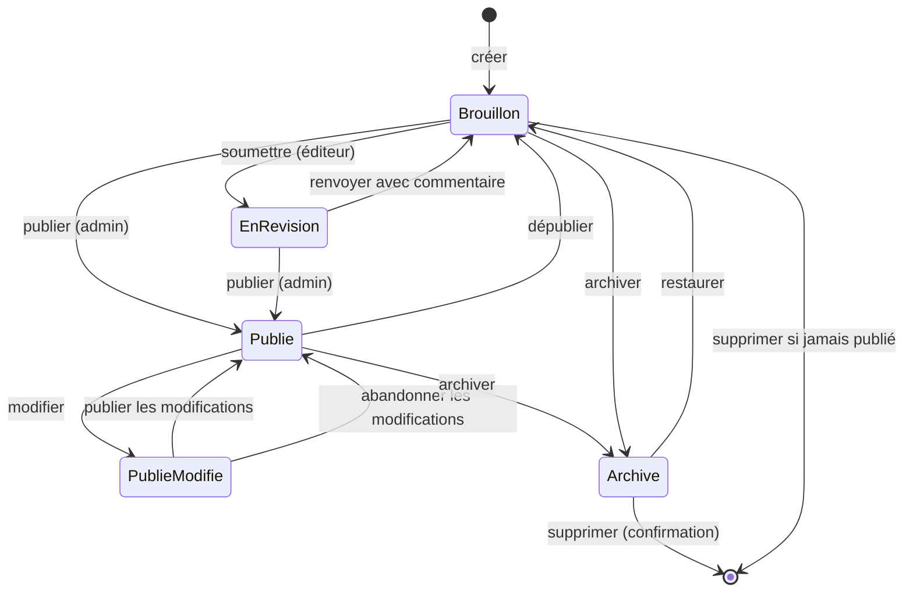
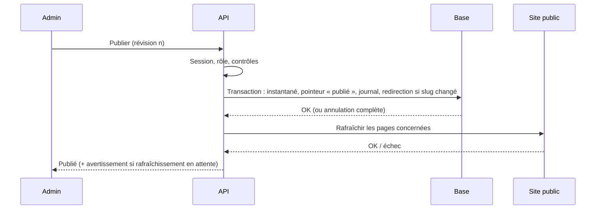

# Admin · Étape 03 — Workflow éditorial et publication

> Livrable du **Prompt 03** de [admin_portfolio.md](../../admin_portfolio.md). S'appuie sur le cahier des charges validé ([02-conception-fonctionnelle.md](02-conception-fonctionnelle.md)).

## Principe : deux copies de chaque contenu

Chaque contenu (un projet, le Hero, un service, les paramètres…) existe sous deux formes :

| Copie | Rôle | Qui la voit |
|---|---|---|
| **Copie de travail** | Ce que tu modifies dans l'admin. Enregistrée en base (jamais seulement dans le navigateur) | L'admin, la prévisualisation |
| **Version publiée** | Instantané figé au moment de la publication | Le site public, **uniquement** |

Le site public ne lit **que** la version publiée. Modifier, enregistrer ou abandonner la copie de travail n'a aucun effet sur le site. C'est ce qui garantit qu'une modification non terminée n'est jamais visible.

Chaque publication et chaque enregistrement manuel ajoutent une entrée à l'**historique des versions** (instantané complet, FR + EN). C'est lui qui permet de comparer et de restaurer.

## États

| État | Sens | Sur le site |
|---|---|---|
| **Brouillon** | Jamais publié, ou nouvelle copie de travail en cours | Rien (jamais publié) ou ancienne version publiée (inchangée) |
| **En révision** | Copie de travail soumise pour relecture (utile quand un éditeur travaille ; seul, tu peux passer directement à la publication) | Idem |
| **Publié** | La dernière version publiée est en ligne ; la copie de travail est identique | Version publiée |
| **Publié · modifié** | En ligne, et une copie de travail contient des changements non publiés | Version publiée (l'ancienne) |
| **Archivé** | Retiré du site et en lecture seule dans l'admin | Rien |

## Enregistrement

| Type | Quand | Effet |
|---|---|---|
| **Automatique** | 3 s après la dernière frappe, et à la sortie du champ | Met à jour la copie de travail **sur le serveur**. Pas de nouvelle version dans l'historique (pour ne pas le noyer) |
| **Manuel** (« Enregistrer », `Ctrl + S`) | À ta demande | Met à jour la copie de travail **et** crée une version « point de sauvegarde » |
| **Publication** | « Publier » | Crée une version « publiée » |

- Indicateur permanent : « Enregistré il y a 12 s », « Enregistrement… », « Hors ligne : modifications en attente ».
- Coupure réseau : les modifications restent dans le navigateur **comme simple tampon** et sont renvoyées au retour du réseau. Elles ne sont jamais considérées comme sauvegardées tant que le serveur ne l'a pas confirmé.
- **Deux onglets ou deux personnes** sur le même contenu : chaque copie de travail porte un numéro de révision. Si quelqu'un d'autre a enregistré entre-temps, l'enregistrement est refusé et l'admin propose de comparer, puis de garder l'une ou l'autre version. Rien n'est écrasé en silence.

## Prévisualiser, comparer, restaurer

| Fonction | Détail |
|---|---|
| **Prévisualiser** | Ouvre la vraie page du site, en FR ou en EN, avec la copie de travail. Lien privé, valable 30 min, réservé aux utilisateurs connectés, marqué « Aperçu » et non indexé |
| **Comparer** | Champ par champ et langue par langue : copie de travail ↔ version publiée, ou deux versions de l'historique. Ajouts en vert, suppressions barrées |
| **Dernière modification** | Date et auteur de la copie de travail et de la version publiée, visibles dans la liste et le formulaire |
| **Restaurer** | Une version de l'historique devient la nouvelle **copie de travail**. Elle n'est pas publiée automatiquement : tu la relis, puis tu publies |
| **Historique conservé** | Toutes les versions publiées ; les 30 derniers points de sauvegarde manuels par contenu |

## Publication

### Contrôles avant publication (côté serveur)

1. Tous les champs obligatoires sont remplis **en FR et en EN** (projets et textes du site).
2. Un projet a au moins un lien valide (`https`).
3. Plus aucune marque « à valider » sur les champs remplis.
4. Toute image utilisée a un texte alternatif FR et EN.
5. Les slugs sont uniques dans chaque langue.
6. Les éléments liés existent et sont publiés (technologies, projets liés d'un service, médias).

Si un contrôle échoue, rien n'est publié. L'admin affiche la liste des problèmes, avec un lien vers chaque champ.

### Publication « tout ou rien »

- Tout ce qui touche la base se fait **dans une seule transaction**. En cas d'erreur, tout est annulé et la version précédente reste en ligne : pas d'état intermédiaire.
- Le **rafraîchissement du site** (vider le cache des pages concernées) a lieu après validation de la transaction. S'il échoue, il est retenté automatiquement, et le cache expire de toute façon en moins de 60 s. Le site ne peut donc pas rester durablement en retard.
- Pages rafraîchies pour un projet : sa page FR et EN, la liste des projets, l'accueil, l'expertise et le sitemap.

### Dépublier, archiver, supprimer

| Action | Effet | Confirmation |
|---|---|---|
| Dépublier | Retiré du site, du sitemap et des listes ; l'adresse renvoie une 404 (410 pour un projet supprimé) | Oui, avec la liste des pages touchées |
| Archiver | Comme dépublier, et lecture seule | Oui |
| Restaurer un archivé | Redevient un brouillon | Non |
| Supprimer | Définitif, historique compris | Oui, en tapant le nom du contenu ; possible seulement si jamais publié ou archivé |
| Abandonner les modifications | La copie de travail redevient identique à la version publiée | Oui |

## Bilingue

- Le français et l'anglais sont **deux jeux de champs indépendants** dans la même copie de travail. Modifier l'un ne modifie jamais l'autre.
- **Projets et textes du site** : les deux langues doivent être complètes pour publier (règle D4). Une fois publié, tu peux corriger une seule langue et republier : l'autre reste telle quelle.
- **Indicateur par langue** dans chaque formulaire : « FR complet · EN 3 champs manquants ».
- Plus tard, les **articles** pourront être publiés dans une seule langue (décision de l'étape 06 du site) : le modèle de version le permet déjà.

## Opérations sensibles

Demandent une confirmation explicite (et, pour celles marquées 🔐, une vérification d'identité récente, détaillée à l'étape 04) :

- Publier, dépublier, archiver, supprimer, abandonner les modifications, restaurer une version.
- Remplacer ou supprimer un média utilisé.
- Modifier les paramètres (nom, email, CV) 🔐.
- Gérer les comptes et les rôles 🔐 ; restaurer une sauvegarde 🔐.

## Règles métier récapitulées

| # | Règle |
|---|---|
| W1 | Le site public ne lit que les versions publiées |
| W2 | Une copie de travail n'existe qu'en base ; le navigateur n'est qu'un tampon temporaire |
| W3 | Publier est tout ou rien (transaction) ; le rafraîchissement du site est retenté jusqu'à succès |
| W4 | Restaurer crée une copie de travail, jamais une publication directe |
| W5 | Un éditeur soumet en révision ; seul un administrateur publie |
| W6 | Toute action d'état (publier, dépublier, archiver, supprimer, restaurer) est inscrite au journal avec son auteur |
| W7 | Pas de publication programmée pour l'instant (pas de besoin réel, à ajouter avec les articles) |
