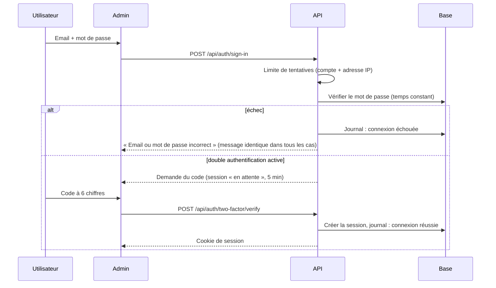

# Admin · Étape 04 — Sécurité et authentification

> Livrable du **Prompt 04** de [admin_portfolio.md](../../admin_portfolio.md).
> **Statut : conception.** Rien de ce qui suit n'est encore implémenté ni testé. Chaque mesure sera marquée « vérifiée » dans le rapport de l'étape 10 seulement après un test réel.

## 1. Modèle d'authentification

| Élément | Choix | Raison |
|---|---|---|
| Bibliothèque | **Better Auth** (choisie à l'étape 11), intégrée à l'API Hono | Code d'authentification éprouvé ; sessions en base ; double authentification intégrée |
| Identifiant | Email + mot de passe | Pas de connexion via un réseau social : un compte de moins à protéger |
| Inscription | **Aucune inscription publique.** Le premier administrateur est créé par une commande en ligne de commande ; les suivants **sur invitation** (lien à usage unique, 48 h) | Personne ne peut créer de compte depuis Internet |
| Mot de passe | 12 caractères minimum, pas de règle de composition imposée, refusé s'il figure dans une fuite connue (vérification anonymisée *k-anonymity*). Haché avec scrypt (paramètres de Better Auth) | Recommandations NIST 800-63B |
| Double authentification | **Obligatoire pour les administrateurs**, facultative pour les éditeurs et lecteurs. Application TOTP (Google Authenticator, 1Password…) + 10 codes de secours à usage unique | Un mot de passe volé ne suffit pas |
| Session | Identifiant aléatoire stocké **en base**, transmis par un cookie `HttpOnly`, `Secure`, `SameSite=Lax`, préfixe `__Secure-` | Le cookie n'est lisible par aucun script ; une session peut être révoquée à tout moment |
| Jetons | **Aucun jeton dans `localStorage` ni `sessionStorage`** | Un script injecté ne peut rien voler |
| Origine | L'admin appelle l'API sur **sa propre adresse** (`/api/*` redirigé vers l'API) | Le cookie reste « même site », sans assouplir `SameSite` (décision de l'étape 11) |

### Connexion

### Déconnexion

- « Se déconnecter » supprime la session **en base** et efface le cookie.
- « Déconnecter toutes mes sessions » révoque toutes les autres sessions du compte (ordinateur oublié, téléphone perdu).
- Changer de mot de passe ou désactiver la double authentification révoque automatiquement toutes les autres sessions.

### Réinitialisation du mot de passe

1. « Mot de passe oublié » → réponse **toujours identique**, que le compte existe ou non.
2. Email (Resend) avec un lien à usage unique, valable **30 minutes**, dont seule l'empreinte est stockée.
3. Nouveau mot de passe → toutes les sessions sont révoquées, un email d'alerte est envoyé, l'événement est journalisé.
4. La double authentification reste exigée à la connexion suivante.

## 2. Règles des sessions

| Règle | Valeur |
|---|---|
| Expiration après inactivité | **2 heures** |
| Durée maximale | **7 jours**, puis reconnexion obligatoire |
| Renouvellement | La date d'expiration est prolongée au plus une fois toutes les 15 min d'activité ; l'identifiant change après la connexion et après toute élévation (protection contre la fixation de session) |
| Vérification récente | Les opérations 🔐 (paramètres, comptes, rôles, sauvegardes, sécurité, suppression définitive) exigent une authentification de **moins de 10 minutes**. Sinon, l'admin redemande le mot de passe (et le code si la double authentification est active) |
| Sessions visibles | Liste des sessions actives : appareil (navigateur, système), ville approximative, première et dernière activité, bouton « Révoquer » |
| Expiration côté interface | Avertissement 2 min avant ; le travail en cours est déjà enregistré côté serveur (étape 03) |

## 3. Matrice des permissions

| Action | Administrateur | Éditeur | Lecteur |
|---|---|---|---|
| Voir le tableau de bord | ✅ | ✅ | ✅ |
| Voir les contenus et leur historique | ✅ | ✅ | ✅ |
| Créer et modifier les contenus | ✅ | ✅ | — |
| Soumettre en révision | ✅ | ✅ | — |
| Publier, dépublier, archiver | ✅ | — | — |
| Supprimer définitivement un contenu | ✅ 🔐 | — | — |
| Importer un média, modifier ses textes | ✅ | ✅ | — |
| Supprimer un média inutilisé | ✅ | ✅ (ceux qu'il a importés) | — |
| Paramètres (nom, email, CV, réseaux) | ✅ 🔐 | — | — |
| Boîte de réception : lire, changer le statut | ✅ | ✅ | — (compteur seulement) |
| Boîte de réception : supprimer | ✅ | — | — |
| Comptes, invitations, rôles | ✅ 🔐 | — | — |
| Journal d'activité | ✅ | Ses propres actions | — |
| Sécurité, sessions de tous les comptes, incidents | ✅ | Ses propres sessions | Ses propres sessions |
| Sauvegardes : voir | ✅ | — | — |
| Sauvegardes : lancer, restaurer | ✅ 🔐 | — | — |

Les permissions sont des **droits nommés** (`project.publish`, `settings.update`…) attribués aux rôles. Ajouter un rôle plus tard ne demande pas de modifier le code des routes. Chaque route de l'API vérifie elle-même le droit : **masquer un bouton dans l'interface n'est jamais une protection**.

Règle anti-verrouillage : impossible de retirer le rôle Administrateur au dernier administrateur, ou de supprimer son compte.

## 4. Menaces identifiées et mesures

| Menace | Exemple | Mesures prévues |
|---|---|---|
| Vol de mot de passe | Hameçonnage, réutilisation d'un mot de passe | Double authentification obligatoire (admin), refus des mots de passe ayant fuité, alerte email à chaque connexion depuis un nouvel appareil |
| Attaque par force brute | Essais de mots de passe en série | Limite de **5 échecs / 15 min par compte** et **20 / 15 min par adresse IP**, puis délai croissant ; compteurs partagés (Upstash Redis) ; alerte après 10 échecs |
| Vol de session | Script injecté qui lit le cookie | Cookie `HttpOnly` ; CSP stricte ; révocation possible |
| Requête forgée (CSRF) | Un site tiers déclenche une action avec ton cookie | `SameSite=Lax` ; **vérification de l'en-tête `Origin`** sur toute requête qui modifie des données ; pas d'action sur `GET` ; protection CSRF de Better Auth |
| Injection de script (XSS) | Texte malveillant dans un contenu ou un message de contact | Échappement automatique de Vue ; texte riche stocké en **structure JSON** (TipTap), converti par une liste blanche côté serveur ; aucun `v-html` sur une donnée non nettoyée ; CSP sans `unsafe-inline` pour les scripts |
| Injection SQL | Champ conçu pour modifier une requête | Requêtes paramétrées uniquement (Drizzle) ; aucune requête construite par concaténation |
| Données invalides | Champ trop long, type inattendu | Validation **côté serveur** de chaque requête par les schémas Zod partagés ; longueurs maximales en base |
| Fichier malveillant | Script déguisé en image, SVG piégé, PDF énorme | Voir §5 |
| Accès direct aux données | Appel à la base ou au stockage sans passer par l'API | Base et stockage privés ; seule l'API possède les identifiants ; l'admin n'a aucun secret |
| Élévation de droits | Un éditeur appelle la route « publier » | Vérification du droit **dans chaque route** ; tests automatiques d'accès refusé par rôle (étape 10) |
| Énumération des comptes | Deviner les emails existants | Messages identiques à la connexion et à la réinitialisation |
| Fuite de secrets | Clé dans le dépôt public, dans un journal | Secrets uniquement dans les variables d'environnement Vercel ; `.env` ignoré par git ; jamais de secret, mot de passe, cookie ou jeton dans les journaux |
| Indexation de l'admin | L'admin apparaît dans Google | `noindex`, `robots.txt` « Disallow », aucun lien depuis le site public |
| Clic piégé (clickjacking) | Admin chargé dans un cadre invisible | `frame-ancestors 'none'` et `X-Frame-Options: DENY` |

## 5. Envoi de fichiers

| Contrôle | Règle |
|---|---|
| Types acceptés | Images : JPEG, PNG, WebP, AVIF ; SVG pour les logos uniquement ; documents : PDF |
| Type réel | Vérifié par la **signature du fichier** côté serveur, pas par l'extension ni le type annoncé par le navigateur |
| Taille | **10 Mo** par image, **15 Mo** par PDF ; dimensions maximales 8 000 px |
| SVG | Nettoyé : scripts, gestionnaires d'événements, liens externes et `foreignObject` retirés ; refusé si le nettoyage échoue |
| Images | Réencodées par le serveur (ce qui retire tout contenu caché) ; métadonnées EXIF supprimées, y compris la position GPS |
| Nom | Le nom d'origine n'est jamais utilisé comme chemin ; chaque fichier reçoit un identifiant aléatoire |
| Stockage | Dépôt R2 **privé** pour les originaux ; seuls les fichiers dérivés utilisés par un contenu publié sont servis publiquement |
| Envoi | URL signée délivrée par l'API après contrôle des droits, valable 5 min, limitée au type et à la taille annoncés ; le fichier n'est accepté qu'après vérification |
| Quota | 50 envois par heure et par compte |

## 6. En-têtes HTTP (admin et API)

| En-tête | Valeur prévue |
|---|---|
| `Content-Security-Policy` | `default-src 'self'` ; scripts du même domaine (empreintes pour les scripts en ligne de Nuxt) ; images `self` + domaine des médias ; `frame-ancestors 'none'` ; `form-action 'self'` ; `base-uri 'none'` |
| `Strict-Transport-Security` | `max-age=63072000; includeSubDomains` |
| `X-Content-Type-Options` | `nosniff` |
| `Referrer-Policy` | `strict-origin-when-cross-origin` (admin : `no-referrer`) |
| `Permissions-Policy` | Caméra, micro, géolocalisation, paiement désactivés |
| `Cross-Origin-Opener-Policy` | `same-origin` |
| `X-Robots-Tag` (admin) | `noindex, nofollow` |
| `Cache-Control` (réponses privées de l'API) | `no-store` |

Le site public reçoit les mêmes en-têtes, avec une CSP adaptée (polices auto-hébergées, médias publics). La CSP sera d'abord activée en mode « rapport seulement » pour vérifier qu'elle ne casse rien.

## 7. Formulaires

- Tous les formulaires de l'admin passent par l'API, avec validation serveur et messages d'erreur reliés aux champs.
- Le formulaire de contact public garde ses protections : champ piège à robots, limite de 5 envois / 10 min, schéma partagé. Le compteur passera d'un stockage en mémoire à Upstash pour fonctionner sur Vercel.

## 8. Gestion des secrets

| Secret | Où |
|---|---|
| `DATABASE_URL` (Neon), clés R2, clé Resend, jeton Upstash, `BETTER_AUTH_SECRET`, clé de chiffrement des sauvegardes | Variables d'environnement du **projet Vercel de l'API uniquement** |
| Site public et admin | **Aucun secret** : ils ne parlent qu'à l'API |
| Local | `.env` (ignoré par git), `.env.example` sans valeur réelle |
| Rotation | Procédure documentée à l'étape 10 ; changer `BETTER_AUTH_SECRET` déconnecte tout le monde |

## 9. Contrôles qui resteront manuels

Les tests automatiques ne suffiront pas à déclarer l'admin sûr (exigence du Prompt 10). Restent à faire à la main :
- relecture de la configuration des en-têtes en production ;
- essai de restauration d'un compte (perte du téléphone de double authentification avec les codes de secours) ;
- vérification qu'aucun secret n'apparaît dans les journaux de Vercel ;
- test d'envoi de fichiers piégés.
