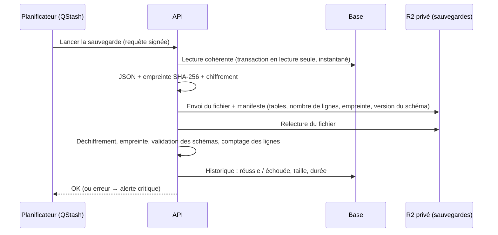

# Admin · Étape 06 — Sauvegarde et restauration

> Livrable du **Prompt 06** de [admin_portfolio.md](../../admin_portfolio.md). **Statut : conception.**
> Règle : une sauvegarde n'est considérée comme fiable qu'**après un essai de restauration réussi**.

## Ce qui est sauvegardé

| Élément | Comment |
|---|---|
| Base de données complète : contenus, traductions, versions, métadonnées SEO, paramètres, comptes, journal | Deux niveaux, voir ci-dessous |
| Références aux médias | Incluses dans la base (table des médias : clé de stockage, dimensions, textes alternatifs, usages) |
| Fichiers médias (images, PDF, CV) | Stockés sur R2 de façon **immuable** : un fichier n'est jamais modifié. Un remplacement crée un nouveau fichier. Une suppression est d'abord logique (corbeille de 30 jours). Les références d'une ancienne sauvegarde restent donc valides |
| Configuration non sensible | Liste des variables d'environnement attendues (noms, pas les valeurs), versions des migrations, dans le dépôt |
| Secrets | **Non sauvegardés** avec les données. Ils sont à conserver séparément dans ton gestionnaire de mots de passe, procédure à l'étape 10 |

## Deux niveaux de sauvegarde

| Niveau | Outil | Fréquence | Conservation | Usage |
|---|---|---|---|---|
| 1. Retour dans le temps | **Neon** (restauration à un instant donné, intégrée à l'hébergeur) | Continu | Selon l'offre Neon (24 h en gratuit) | Erreur récente : « revenir à 10 h ce matin » |
| 2. Export quotidien | Export de toutes les tables en JSON, **chiffré** (AES-256-GCM) et envoyé dans un dépôt R2 **privé**, séparé des médias | Chaque jour à 3 h (UTC), et à la demande | 30 quotidiennes + 12 mensuelles | Panne de l'hébergeur, suppression du projet Neon, erreur ancienne |

Pourquoi un export applicatif plutôt que `pg_dump` : les fonctions Vercel n'ont pas l'outil `pg_dump`, et le dépôt GitHub n'est pas utilisé pour l'instant (pas de GitHub Actions). L'export JSON passe par les mêmes schémas que l'API, ce qui permet aussi de le **vérifier** facilement.

## Déroulement d'une sauvegarde

- **Historique des sauvegardes** dans l'admin : date, déclencheur (planifiée ou manuelle, par qui), taille, durée, résultat, vérification d'intégrité.
- **Échec** (envoi, relecture ou vérification) : alerte critique, email, incident ouvert (étape 05).
- **Sauvegarde manquante** : si aucune sauvegarde réussie depuis 36 h, alerte.

## Restauration contrôlée

Réservée à l'administrateur, avec vérification d'identité récente (🔐).

1. **Choisir** une sauvegarde dans l'historique.
2. **Vérifier** : déchiffrement, empreinte, version du schéma, résumé (« 5 projets, 214 versions, 31 médias… »). Rien n'est encore modifié.
3. **Sauvegarde de sécurité** : une sauvegarde de l'état actuel est faite automatiquement juste avant.
4. **Restaurer** : dans une **seule transaction**, les tables de contenu sont vidées puis rechargées. En cas d'erreur, tout est annulé.
5. **Après** : sessions révoquées (reconnexion), site public rafraîchi, événement journalisé, email de confirmation.

Options :
- **Restauration partielle** : un seul contenu, par exemple un projet supprimé par erreur, réinjecté comme **brouillon**.
- **Version de schéma différente** : la sauvegarde est restaurée dans une base vide, puis les migrations la mettent à niveau. Une sauvegarde plus récente que le code est refusée.

## Essai de restauration (obligatoire)

| Quand | Quoi |
|---|---|
| Avant la mise en production | Restauration complète d'un export dans la base Docker locale, puis vérification que le site affiche les mêmes contenus |
| Chaque mois | Même essai sur la dernière sauvegarde mensuelle ; résultat noté dans l'historique (« essai de restauration réussi le … ») |
| Après chaque changement du modèle de données | Essai avec une sauvegarde antérieure, pour vérifier la mise à niveau |

Tant qu'aucun essai n'a réussi, le tableau de bord affiche « Sauvegardes : non vérifiées ».

## Protection des sauvegardes

- Dépôt R2 dédié, **sans accès public**, clés d'accès distinctes de celles des médias, utilisées seulement par l'API.
- Fichiers chiffrés. La clé est conservée dans les variables d'environnement de l'API **et** dans ton gestionnaire de mots de passe (sans elle, une sauvegarde est illisible).
- Aucune route ne permet de télécharger une sauvegarde depuis l'admin : on peut seulement la vérifier ou la restaurer. Le téléchargement manuel passe par le tableau de bord Cloudflare.

## Reprise après incident (résumé)

| Situation | Action |
|---|---|
| Contenu modifié ou supprimé par erreur | Historique des versions du contenu (étape 03) ; sinon restauration partielle |
| Erreur importante dans les dernières heures | Retour dans le temps Neon |
| Base perdue ou projet Neon supprimé | Nouvelle base Neon → migrations → restauration du dernier export → mise à jour de `DATABASE_URL` → vérification du site |
| Média supprimé par erreur | Corbeille (30 jours) |
| Compte administrateur inaccessible | Codes de secours ; sinon commande de récupération exécutée avec les accès à la base (procédure à l'étape 10) |

La procédure détaillée, pas à pas, sera rédigée et testée à l'étape 10.
