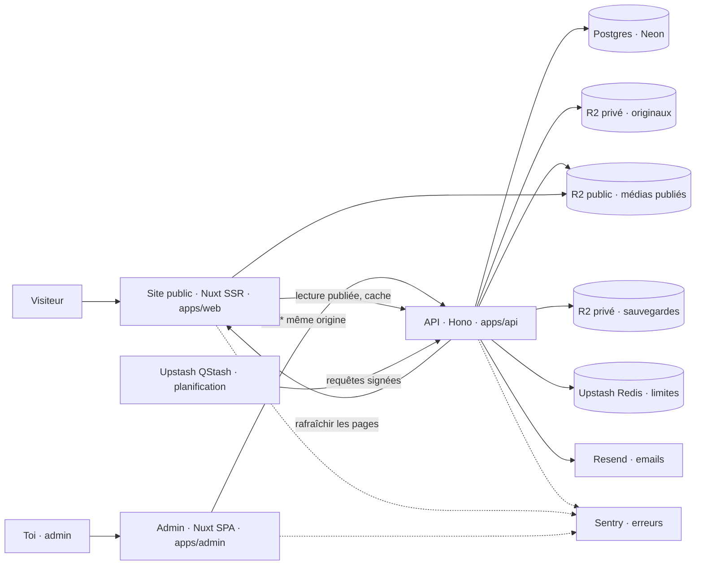
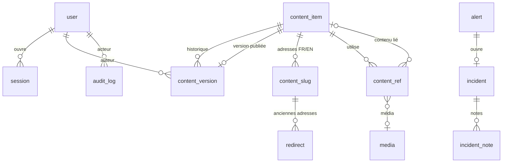

# Admin · Étape 08 — Architecture technique, modèle de données et contrats d'API

> Livrable du **Prompt 08** de [admin_portfolio.md](../../admin_portfolio.md). Part de l'existant (audit 01) et prolonge les choix de l'étape 11 du site ([11-architecture-technique.md](../11-architecture-technique.md)).
> L'API Hono existante (`/health`, `/openapi.json`, `POST /public/contact`) est **réutilisée** ; rien n'est remplacé.

## 1. Architecture



| Brique | Rôle | Accès |
|---|---|---|
| **Site public** (`apps/web`, existant) | Lit **uniquement** les versions publiées via `/public/*` ; mis en cache 60 s, rafraîchi à chaque publication | Aucun secret |
| **Admin** (`apps/admin`, nouveau) | Application Nuxt **rendue dans le navigateur**, non indexée, interface en français | Aucun secret ; appelle `/api/*` sur sa propre adresse (réécrite vers l'API) pour garder le cookie de session « même site » |
| **API** (`apps/api`, étendue) | Seule à parler à la base, au stockage, aux emails. Vérifie session, droits, données ; journalise | Détient tous les secrets |
| **Base** (Neon Postgres) | Contenus, versions, comptes, journal, mesures | Deux rôles Postgres : `app` (API) et `owner` (migrations) |
| **Stockage** (Cloudflare R2) | 3 dépôts : originaux privés, médias publiés (domaine public), sauvegardes chiffrées | Clés seulement dans l'API |
| **Planification** (QStash) | Sondes toutes les 5 min, sauvegarde quotidienne, purges | Signature vérifiée par l'API |

Règle de l'étape 11 confirmée : **l'admin n'accède jamais directement à la base ni au stockage privé.** Les fichiers vont vers R2 par une URL signée délivrée par l'API, puis l'API les vérifie avant de les accepter.

## 2. Organisation du code

```
apps/
  web/        site public (existant) — composables useContent/useSite branchés sur l'API
  admin/      nouveau — Nuxt 4, ssr: false, mêmes design tokens, TipTap pour le texte riche
  api/
    src/
      auth/            Better Auth (configuration, double authentification, sessions)
      routes/public/   contact (existant), site, pages, projets, profil, expertise, sitemap, aperçu
      routes/admin/    content, media, messages, users, security, audit, monitoring, backups, dashboard
      routes/internal/ checks, backup, maintenance (QStash)
      services/        workflow (publier, versions), media (R2, sharp), revalidate, audit, alerts, backup
      db/schema/       tables Drizzle (contact existant + nouvelles)
      scripts/         create-admin, import-seed, restore-local
packages/
  shared/     + schémas Zod de chaque type de contenu, permissions par rôle, contrats d'API
  design-tokens/  inchangé, utilisé aussi par l'admin
```

Les **schémas Zod partagés** sont le contrat unique : l'admin valide ses formulaires avec, l'API valide chaque requête avec, et le site public en tire ses types. Le site public garde la même forme de données qu'aujourd'hui : ses composants ne changent pas.

## 3. Modèle de données

### Choix : un document versionné par contenu

Plutôt qu'une paire de tables par entité (`Project` + `ProjectTranslation`, `Experience`…), chaque contenu est un **document** (JSON validé par un schéma Zod) dans une table commune, avec ses versions.

| | Document versionné (choisi) | Tables relationnelles par entité |
|---|---|---|
| Brouillon / publié / historique | Une seule mécanique pour tous les types | À recoder pour chaque table et chaque traduction |
| Instantané, comparaison, restauration | Copie d'un JSON | Copie coordonnée de plusieurs lignes |
| Ajouter un champ | Modifier le schéma Zod | Migration SQL à chaque fois |
| Intégrité des liens (technologies, médias, projets liés) | Table de références reconstruite à chaque enregistrement | Clés étrangères natives |
| Requêtes (slug, ordre, statut) | Colonnes dédiées hors JSON + tables `content_slug`, `content_ref` | Natives |

Les liens critiques gardent des contraintes réelles : `content_slug` (unicité des adresses) et `content_ref` (usages des médias et des compétences, qui servent à bloquer les suppressions).

### Correspondance avec les entités du cahier des charges

| Entité demandée | Où |
|---|---|
| AdminUser, Session | Tables de Better Auth (`user`, `session`, `account`, `verification`, `two_factor`) + colonne `role` |
| Role, Permission | **Pas de table** : les 3 rôles et leurs droits sont définis dans `@portfolio/shared` (aucun besoin d'éditer les droits depuis l'admin). Ajouter un rôle = une ligne de code |
| Project, ProjectTranslation | `content_item` de type `project` ; FR et EN dans le même document, champs séparés |
| ProjectImage | Références de médias dans le document + `content_ref` |
| Article, ArticleTranslation, Category | **Reportés** (décision D1). Le type `article` est prévu dans l'énumération |
| Skill, Experience, Education, Certification | `content_item` de types `skill`, `experience`, `education`, `certification` |
| PageContent, PageTranslation | `content_item` de type `block` (Hero, profil, introductions, pied de page, pages légales…) |
| SeoMetadata | Champ `seo` du document de chaque projet et de chaque bloc de page |
| SiteSettings | `content_item` de type `settings` (unique), donc versionné et publié comme le reste (point 5 validé) |
| Media | `media` |
| AuditLog | `audit_log` |
| Backup | `backup` |
| SecurityIncident | `alert`, `incident`, `incident_note` |
| (ajouts) | `content_version`, `content_slug`, `redirect`, `content_ref`, `invitation`, `login_attempt`, `service_check`, `contact_messages` (existant) |

### Tables



| Table | Colonnes principales | Contraintes et index |
|---|---|---|
| `content_item` | `id` uuid, `type` (project, block, skill, domain, service, step, experience, education, certification, settings), `key` (`PRJ-02`, `hero`…), `position`, `status` (draft, in_review, published, archived), `working` jsonb, `working_revision` int, `working_updated_at`, `working_updated_by`, `published_version_id`, `pending_fields` text[], `featured` bool, `created_at`, `archived_at` | `unique(type, key)` ; index `(type, status, position)` ; `check` : un archivé n'a pas de version publiée active |
| `content_version` | `id`, `item_id`, `number`, `kind` (checkpoint, published, restored, import), `data` jsonb, `created_by`, `created_at` | `unique(item_id, number)` ; purge des points de sauvegarde au-delà de 30 par contenu |
| `content_slug` | `item_id`, `locale`, `slug`, `type` | `unique(type, locale, slug)` ; seules les adresses **publiées** |
| `redirect` | `type`, `locale`, `from_slug`, `item_id`, `created_at` | `unique(type, locale, from_slug)` → 301 |
| `content_ref` | `item_id`, `media_id` ou `ref_item_id`, `field`, `published` bool | Index par `media_id` et `ref_item_id` (blocage des suppressions) |
| `media` | `id`, `kind` (image, svg, pdf), `folder`, `original_key`, `variants` jsonb (largeurs, formats, clés publiques), `mime`, `bytes`, `width`, `height`, `sha256`, `alt` jsonb {fr, en}, `caption` jsonb, `credit`, `uploaded_by`, `created_at`, `deleted_at` (corbeille) | `unique(sha256)` (évite les doublons) ; fichiers jamais réécrits |
| `contact_messages` | Existante + `read_at`, `answered_at`, `archived_at` | Purge des archivés après 12 mois |
| `user` (Better Auth) | `email`, `name`, `role` (admin, editor, viewer), `two_factor_enabled`, `disabled_at` | Email unique ; trigger : au moins un admin actif |
| `invitation` | `email`, `role`, `token_hash`, `expires_at`, `accepted_at`, `invited_by` | Usage unique, 48 h |
| `login_attempt` | `at`, `user_id` (si le compte existe), `ip_trunc`, `ua_family`, `result` | Purge à 90 jours |
| `audit_log` | `id` bigserial, `at`, `actor_id`, `actor_role`, `action`, `resource_type`, `resource_id`, `resource_label`, `result`, `severity`, `request_id`, `ip_trunc`, `geo`, `ua_family`, `meta` jsonb, `prev_hash`, `hash` | Rôle `app` : `INSERT` et `SELECT` seulement ; purge par fonction dédiée |
| `alert` | `rule`, `severity`, `status` (open, acknowledged, resolved), `first_at`, `last_at`, `count`, `data` | Une alerte ouverte par règle et par cible |
| `incident`, `incident_note` | `number`, `title`, `severity`, `status`, `alert_id`, `opened_by`, `resolved_at`, `resolution` ; notes horodatées | — |
| `service_check` | `at`, `target` (web, api, db, storage), `ok`, `status_code`, `ms`, `error` | Index `(target, at)` ; détail 30 jours, puis moyennes journalières |
| `backup` | `started_at`, `finished_at`, `trigger`, `triggered_by`, `object_key`, `bytes`, `sha256`, `schema_version`, `row_counts` jsonb, `result`, `verified_at`, `restore_tested_at`, `error` | — |

### Import des contenus actuels

Le script `import-seed` lit `apps/web/app/content/*.ts` et les textes éditoriaux des fichiers de langue, puis crée pour chaque contenu :
- un `content_item` ;
- une version `import` publiée, pour que le site reste identique.

Les champs « à valider » (`pending`) sont repris dans `pending_fields`. Les projets sans lien restent en ligne, mais leur prochaine publication exigera un lien (règle D6).

## 4. Contrats d'API

Conventions :
- JSON, validation Zod de chaque entrée, documentation OpenAPI générée (`/openapi.json`, existante).
- **Erreurs au format RFC 9457** (`application/problem+json`) : `type`, `title`, `status`, `detail`, `code` stable (`publish.missing_link`, `content.conflict`…), `errors[]` avec le chemin du champ.
- En-tête `X-Request-Id` sur chaque réponse, repris dans le journal.
- Toute route `/admin/*` exige une session valide et un droit nommé. Toute requête qui modifie quelque chose vérifie l'en-tête `Origin`.

### Public (sans connexion, versions publiées seulement, cache)

| Route | Rôle |
|---|---|
| `GET /public/site?locale=` | Paramètres publiés (nom, initiales, email, réseaux, CV, disponibilité) + pied de page |
| `GET /public/home?locale=` | Hero, profil court, projets mis en avant, services, parcours, méthode, ruban |
| `GET /public/projects?locale=` | Liste ordonnée des projets publiés (forme actuelle de `useProjects`) |
| `GET /public/projects/:slug?locale=` | Étude de cas + slug dans l'autre langue + projet suivant ; 301 si ancienne adresse, 404 sinon |
| `GET /public/profile?locale=` · `GET /public/expertise?locale=` · `GET /public/pages/:key?locale=` | Pages Profil, Expertise, textes et pages légales |
| `GET /public/sitemap` | Adresses publiées FR/EN (utilisé par `sitemap.xml` du site) |
| `GET /public/cv/:locale` | Redirection vers le PDF publié |
| `POST /public/contact` | **Existant**, inchangé (compteur déplacé vers Upstash) |
| `GET /public/preview/:token` | Aperçu d'une copie de travail : jeton signé, 30 min, réservé à une session admin |

### Authentification (Better Auth, monté sur `/api/auth/*`)

`sign-in/email`, `sign-out`, `get-session`, `two-factor/enable` · `verify-totp` · `generate-backup-codes` · `verify-backup-code`, `forget-password`, `reset-password`, `change-password`, `list-sessions`, `revoke-session`, `revoke-other-sessions`. Configuration : pas d'inscription publique, cookies `__Secure-` `HttpOnly` `SameSite=Lax`, limites via Upstash.

### Admin

| Domaine | Routes |
|---|---|
| Moi | `GET /admin/me` (compte, rôle, droits, fraîcheur de l'authentification) |
| Contenus (tous types) | `GET /admin/content?type&status&q` · `POST /admin/content` · `GET /admin/content/:id` · `PATCH /admin/content/:id` (enregistrement auto, `{revision, data}`, **409** si conflit) · `POST …/:id/checkpoint` · `submit` · `publish` · `unpublish` · `archive` · `unarchive` · `discard` · `duplicate` · `DELETE /admin/content/:id` · `PUT /admin/content/order` |
| Versions | `GET …/:id/versions` · `GET …/:id/versions/:n` · `GET …/:id/diff?from&to` · `POST …/:id/versions/:n/restore` · `POST …/:id/preview-token` |
| Validation | `GET …/:id/publish-check` (liste des blocages, sans publier) |
| Médias | `POST /admin/media/uploads` (→ URL signée) · `POST /admin/media/uploads/:id/complete` (vérification, optimisation) · `GET /admin/media?folder&q` · `GET`/`PATCH /admin/media/:id` · `GET …/:id/usages` · `POST …/:id/replace` · `DELETE …/:id` (**409** si utilisé) |
| Boîte de réception | `GET /admin/messages?status` · `GET`/`PATCH /admin/messages/:id` · `DELETE /admin/messages/:id` |
| Comptes | `GET /admin/users` · `POST /admin/invitations` · `PATCH /admin/users/:id` · `DELETE /admin/users/:id` 🔐 |
| Sécurité | `GET /admin/security/sessions` · `DELETE /admin/security/sessions/:id` · `GET /admin/security/logins` |
| Journal | `GET /admin/audit?severity&action&actor&from&to` · `GET /admin/audit/integrity` |
| Surveillance | `GET /admin/monitoring/status` · `GET /admin/monitoring/checks?target&range` · `GET`/`PATCH /admin/alerts/:id` · `GET`/`POST /admin/incidents` · `PATCH /admin/incidents/:id` · `POST /admin/incidents/:id/notes` |
| Sauvegardes | `GET /admin/backups` · `POST /admin/backups` 🔐 · `POST /admin/backups/:id/verify` · `POST /admin/backups/:id/restore` 🔐 (phrase de confirmation) |
| Tableau de bord | `GET /admin/dashboard` · `GET /admin/translations` (contenus incomplets) |

### Interne (QStash, signature obligatoire)

`POST /internal/checks` (sondes), `POST /internal/backup`, `POST /internal/maintenance` (purges, contrôle de la chaîne du journal, alerte « aucune sauvegarde depuis 36 h »).

## 5. Publication et mise à jour du site

1. `POST /admin/content/:id/publish` → contrôles → **transaction** : nouvelle version publiée, pointeur, `content_slug`, `redirect`, `content_ref.published`, journal.
2. Après validation : l'API demande au site de **rafraîchir** les pages concernées (cache des pages du site public sur Vercel, régénération à la demande avec un jeton secret).
3. Sans réponse du site : nouvel essai via QStash. Le cache de 60 s garantit de toute façon la mise à jour en moins d'une minute.

Le mécanisme exact de rafraîchissement sur Vercel sera vérifié au module « Projets » de l'étape 09. Tant qu'il ne l'est pas, la règle de secours (cache de 60 s) s'applique.

## 6. Stratégie de sécurité (rappel de l'étape 04)

Better Auth + double authentification obligatoire pour les administrateurs, cookies `HttpOnly`/`Secure`/`SameSite=Lax`, vérification de `Origin`, droits contrôlés dans chaque route, Zod partout, Drizzle paramétré, texte riche en JSON nettoyé, CSP stricte, envois vérifiés par signature de fichier et réencodés, secrets uniquement dans l'API, journal en ajout seulement et chaîné.

## 7. Déploiement

| Élément | Choix |
|---|---|
| Hébergement | 3 projets Vercel : `web`, `api`, `admin` (réécriture `/api/*` de l'admin vers l'API) |
| Base | Neon (branche `main` pour la production, branche de développement possible) ; Docker Postgres 17 en local (existant) |
| Migrations | `drizzle-kit` ; appliquées avant chaque déploiement de l'API |
| Déploiement sans GitHub (ta décision) | **Vercel CLI depuis ta machine** (`vercel deploy --prod`), application par application. Quand tu créeras ton dépôt, on pourra relier les projets Vercel pour un déploiement automatique |
| Variables | API : `DATABASE_URL`, `BETTER_AUTH_SECRET`, `BETTER_AUTH_URL`, `R2_*` (3 dépôts), `RESEND_API_KEY`, `UPSTASH_REDIS_*`, `QSTASH_*`, `BACKUP_ENCRYPTION_KEY`, `REVALIDATE_TOKEN`, `ALLOWED_ORIGINS`, `SENTRY_DSN`. Site et admin : uniquement des adresses publiques |
| Environnements | Local (Docker, R2 de test ou dossier local simulé), production |

## 8. Ordre de développement (étape 09)

| # | Module | Livré quand |
|---|---|---|
| 1 | Initialisation : `apps/admin`, schémas partagés, tables de base, import des contenus | L'admin démarre, la base contient le site actuel |
| 2 | Authentification, sessions, rôles, journal | Connexion + double authentification fonctionnelles, routes refusées sans droit |
| 3 | Site public branché sur l'API publique | Le site affiche exactement la même chose qu'aujourd'hui, mais depuis la base |
| 4 | Médiathèque (R2, optimisation) | Import d'une image réelle, utilisée puis protégée contre la suppression |
| 5 | Paramètres | Ton nom, ta photo, ton CV visibles en ligne après publication |
| 6 | Projets + workflow complet | Création, liens, publication, historique, aperçu, rafraîchissement du site |
| 7 | Textes du site, compétences, parcours, services, méthode | Tout le contenu éditorial modifiable |
| 8 | Boîte de réception + notification email | Les messages de contact sont lisibles |
| 9 | Traductions, SEO, tableau de bord | Indicateurs réels |
| 10 | Surveillance, alertes, incidents, sauvegardes | Sondes, sauvegarde chiffrée **et essai de restauration** |

Chaque module se termine par : fichiers modifiés, fonctionnalités opérationnelles, tests réalisés, et vérification sur le site public.
