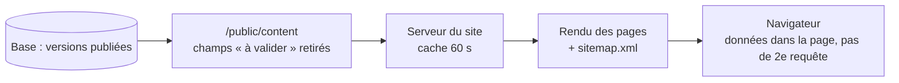
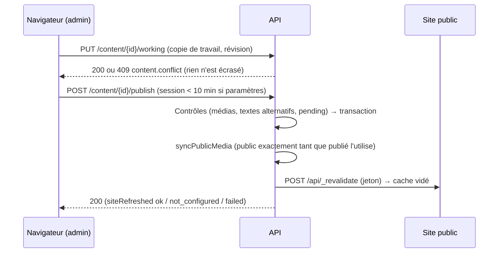
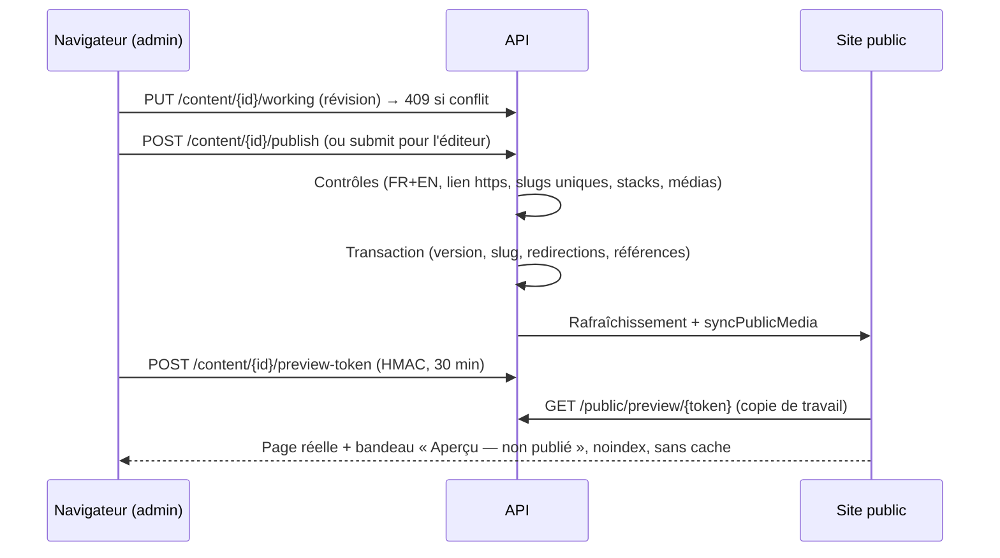
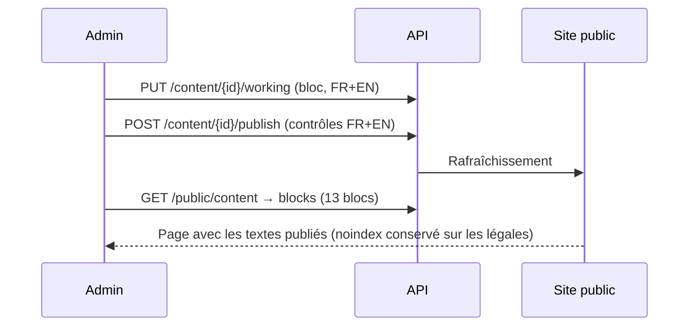
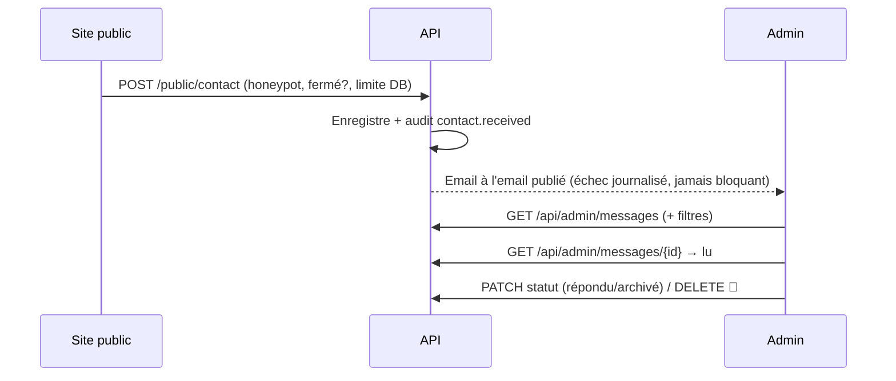
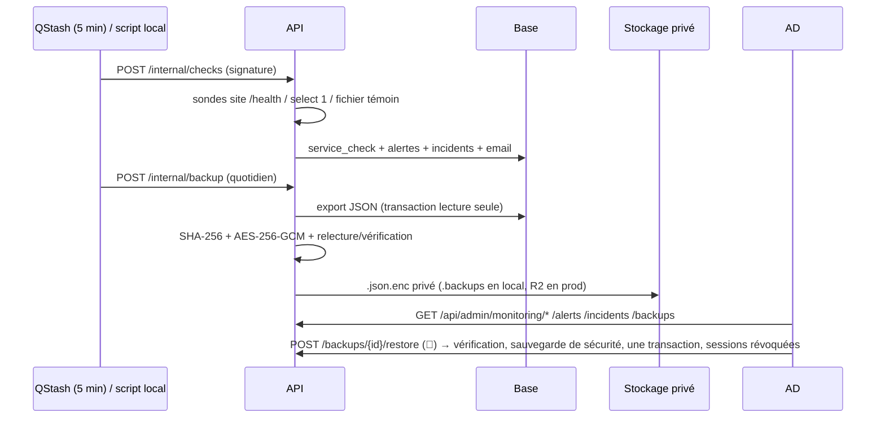

# Admin · Étape 09 — Journal de développement

> Suivi du **Prompt 09** de [admin_portfolio.md](../../admin_portfolio.md) : un module à la fois. Pour chacun : fichiers, ce qui fonctionne réellement, tests réalisés, limites.
> Ordre : [08-architecture-donnees.md §8](08-architecture-donnees.md).

| # | Module | État |
|---|---|---|
| 1 | Initialisation, schémas, tables, import des contenus | ✅ 2026-11-07 |
| 2 | Authentification, sessions, rôles, journal | ✅ 2026-11-07 |
| 3 | Site public branché sur l’API | ✅ 2026-11-07 |
| 4 | Médiathèque | ✅ 2026-11-07 (stockage local ; R2 à vérifier) |
| 5 | Paramètres | ✅ 2026-11-07 (stockage local ; R2 à vérifier au déploiement) |
| 6 | Projets et workflow | ✅ 2026-11-08 (stockage local ; R2 à vérifier au déploiement, éditeur riche volontairement absent) |
| 7 | Textes, compétences, parcours, services, méthode | ✅ 2026-11-08 (éditeur riche volontairement absent, modèle légal à compléter) |
| 8 | Boîte de réception | ✅ 2026-11-08 (Resend non configuré en dev, Upstash à brancher) |
| 9 | Traductions, SEO, tableau de bord | ✅ 2026-11-08 |
| 10 | Surveillance, alertes, sauvegardes | ✅ 2026-11-08 (R2 backup non testé, Sentry sans DSN en dev, QStash non branché en production) |
| 11 | Tests, audit de sécurité, documentation | ✅ 2026-11-08 (2 bugs corrigés, docs technique/utilisateur/procédures) |

---

## Module 1 — Initialisation

### Fichiers

| Fichier | Rôle |
|---|---|
| `packages/shared/src/content.ts` (nouveau) | Types de contenu et schémas Zod des documents (paramètres, Hero, profil, projet, compétence, domaine, service, étape, expérience, formation, certification). Ils valident les **brouillons** ; les règles de publication viendront au module 6 |
| `packages/shared/package.json` | Export `@portfolio/shared/content` |
| `apps/api/src/db/schema/content.ts` (nouveau) | Tables `content_item`, `content_version`, `content_slug`, `redirect`, `content_ref` + énumérations |
| `apps/api/src/db/migrations/0001_*.sql` | Migration générée par drizzle-kit |
| `apps/api/src/scripts/import-seed.ts` (nouveau) | Import des contenus actuels du site comme version 1 publiée ; `pnpm --filter @portfolio/api db:seed` |
| `apps/api/src/index.ts` | `GET /api/health` (même contrôle que `/health`, atteint par le proxy de l'admin) |
| `apps/admin/*` (nouveau) | Application Nuxt 4 rendue dans le navigateur : proxy `/api/**`, en-têtes `noindex` / `DENY` / `no-referrer`, `robots.txt` « Disallow », coquille (barre latérale, barre du haut, tiroir mobile), tableau de bord minimal |
| `packages/design-tokens/tokens.json` | Couleurs `warning`, `danger`, `info` (claire et sombre), pour les statuts et alertes de l'admin |
| `package.json`, `.env.example`, `AGENTS.md` | `pnpm dev:admin`, variable `ADMIN_API_ORIGIN`, documentation |

### Choix faits pendant l'import

- **Technologies des projets = compétences.** Les technologies citées par un projet ou par le ruban, mais absentes de la matrice Expertise, sont importées comme compétences **masquées** : Dart, JavaScript, Nuxt, TypeScript, Hono, PostgreSQL, Vercel. La page Expertise ne change donc pas, et chaque technologie pointe vers une vraie compétence.
- **Ruban** : porté par les compétences (position, logo, couleurs). « LLM APIs » est rattaché à « Intégration d'API de LLM » et « RAG » à « RAG / agents » ; leur libellé d'origine est conservé.
- **Champs « à valider »** : gardés dans `pending_fields` (Prince Edja : contexte, problématique ; Retrouve Moi : problématique, objectifs, technologies ; Portfolio : solution).
- **Paramètres** : importés vides (nom, email, CV…), comme aujourd'hui sur le site.
- Les **noms des domaines** n'existaient qu'en une langue : la même valeur est mise en FR et en EN, à corriger dans l'admin.

### Ce qui fonctionne

- Base locale : 5 nouvelles tables, migration appliquée.
- Import : **51 contenus** (1 paramètres, 2 blocs, 5 projets, 27 compétences, 5 domaines, 4 services, 5 étapes, 1 expérience, 1 formation) et **23 références**, tous publiés (version 1 « import »). Tout est validé par les schémas **avant** d'écrire, dans une seule transaction.
- Relancer l'import ne modifie rien (contenus déjà présents laissés intacts).
- Admin : démarre, joint l'API par son propre `/api`, affiche l'état **mesuré** de l'API et de la base.

### Tests réalisés

| Test | Résultat |
|---|---|
| `pnpm typecheck` (5 paquets) | ✅ |
| Build de production de l'admin | ✅ |
| Import, puis second import | ✅ 51 créés, puis 0 créé / 51 laissés intacts |
| Contrôle en base : champs « à valider », adresses EN, ordre du ruban, pointeur de version publiée | ✅ conformes au site actuel |
| `GET /api/health` via le proxy de l'admin | ✅ `{"status":"ok","database":"up"}` |
| En-têtes de l'admin | ✅ `X-Robots-Tag: noindex, nofollow`, `X-Frame-Options: DENY`, `Referrer-Policy: no-referrer` ; `robots.txt` interdit tout |
| Navigateur (1440 px et 390 px) | ✅ aucune erreur console, aucun débordement, tiroir mobile fonctionnel |

### Limites connues

- Aucune donnée de contenu n'est encore exposée par l'API : les routes admin attendront l'authentification (module 2), le site public continue de lire ses fichiers jusqu'au module 3.
- Le script d'import lit les fichiers de `apps/web/app/content`. Ils seront déplacés dans l'API au module 3, quand le site n'en aura plus besoin.

---

## Module 2 — Authentification, sessions, rôles, journal

### Fichiers

| Fichier | Rôle |
|---|---|
| `packages/shared/src/permissions.ts` | Droits nommés et matrice des rôles (administrateur, éditeur, lecteur) de l’étape 04 |
| `apps/api/src/db/schema/auth.ts` | Tables de Better Auth : `user` (+ `role`), `session`, `account`, `verification`, `two_factor`, `rate_limit` |
| `apps/api/src/db/schema/security.ts` | `audit_log` (chaîné) et `login_attempt` |
| `apps/api/src/db/migrations/0002_*.sql`, `0003_audit_guards.sql` | Tables ; puis garde-fous en base : journal en ajout seulement (y compris `TRUNCATE`), purge limitée aux événements de plus de 12 mois, rôles limités à 3 valeurs, impossible de supprimer ou rétrograder le dernier administrateur |
| `apps/api/src/auth/index.ts` | Better Auth 1.7.12 (voir réglages ci-dessous) |
| `apps/api/src/middleware/admin.ts` | `proxyGuard` (secret du proxy, IP du visiteur, identifiant de requête), `originGuard` (CSRF), `requireSession` (session, 7 jours maximum, double authentification obligatoire pour un administrateur), `requirePermission`, erreurs RFC 9457 |
| `apps/api/src/routes/admin/security.ts` | `GET /api/admin/me`, `GET`/`DELETE /api/admin/security/sessions`, `GET /api/admin/security/logins`, `GET /api/admin/audit`, `GET /api/admin/audit/integrity` (documentées dans `/openapi.json`) |
| `apps/api/src/services/audit.ts`, `mail.ts`, `lib/request-meta.ts` | Journal chaîné (SHA-256, verrou de chaîne) ; emails via l’API HTTP de Resend (affichés dans la console en développement) ; IP tronquée et famille de navigateur |
| `apps/api/src/scripts/create-admin.ts` | `pnpm --filter @portfolio/api admin:create -- --email … --name …` (mot de passe saisi sans affichage) |
| `apps/admin/server/routes/api/[...path].ts` | Proxy `/api/**` → API, avec secret partagé et IP du visiteur |
| `apps/admin/app/composables/useAuth.ts`, `middleware/auth.global.ts`, `plugins/api-errors.client.ts` | Client Better Auth, état « qui suis-je », redirections, retour à la connexion si la session expire |
| `apps/admin/app/pages/connexion.vue`, `mot-de-passe-oublie.vue`, `reinitialiser.vue`, `double-authentification.vue`, `compte.vue`, `sessions.vue`, `journal.vue`, `layouts/auth.vue` | Écrans du module |

### Réglages de sécurité appliqués

| Règle (étape 04) | Mise en œuvre |
|---|---|
| Pas d’inscription publique | `disableSignUp`, routes d’inscription désactivées ; premier compte en ligne de commande |
| Mot de passe | 12 à 128 caractères, refusé s’il figure dans une fuite connue (Have I Been Pwned, k-anonymat), haché en scrypt |
| Double authentification | TOTP + 10 codes de secours chiffrés en base ; **obligatoire pour un administrateur** : toutes les routes admin répondent `mfa.setup_required` tant qu’elle n’est pas active |
| Session | Cookie `pf-admin.session_token`, `HttpOnly`, `SameSite=Lax`, `Secure` en HTTPS ; expiration après **2 h d’inactivité** (prolongée au plus toutes les 15 min), **7 jours maximum** (vérifié par l’API) |
| Tentatives répétées | 5 échecs en 15 min sur un compte, ou 20 depuis une même adresse → blocage 15 min ; compteurs en base (valables sur Vercel) ; le second facteur a aussi son verrou (5 essais) |
| Énumération des comptes | Même réponse pour un compte inconnu et un mauvais mot de passe ; même message pour « mot de passe oublié » |
| CSRF | Vérification de `Origin` sur toute requête qui modifie quelque chose (Better Auth et routes admin) |
| Accès direct à l’API | `/api/*` refusé sans le secret du proxy de l’admin ; l’IP transmise n’est acceptée que par ce chemin |
| Réinitialisation | Lien à usage unique valable 30 min ; toutes les sessions fermées ensuite ; email de notification |
| Journal | Connexions, échecs, blocages, double authentification, fin de session, révocations, refus d’accès, création de compte ; IP tronquée ; jamais de mot de passe, code ou cookie |
| Télémétrie | Désactivée (Better Auth n’envoie rien) |

### Tests réalisés

**API, par le vrai proxy de l’admin : 36/36**
- Accès direct sans secret refusé.
- `/me` sans session : 401.
- Connexion depuis une autre origine ou sans `Origin` : refusée.
- Réponse identique pour un compte inconnu et un mauvais mot de passe.
- Préfixe et attributs du cookie.
- Routes bloquées tant que la double authentification n’est pas activée ; activation par code TOTP réel ; mauvais code refusé.
- Déconnexion effective.
- Connexion en deux étapes, sans session avant le code.
- Code de secours accepté une seule fois.
- Liste des sessions (appareil, IP tronquée) ; révocation d’une autre session, qui est bien déconnectée ; refus de révoquer la session courante.
- Lecteur : refus des droits (historique, toutes les sessions, journal).
- Journal complet et sans secret ; chaîne intègre.
- Blocage après 5 échecs, même avec le bon mot de passe.
- Session de plus de 7 jours et session inactive refusées.
- `X-Request-Id` présent.

**Navigateur (Chrome) : 17/17**
- Redirection vers la connexion avec retour à la page demandée.
- Message d’erreur générique.
- Mise en place de la double authentification : QR code, clé manuelle, 10 codes, bouton bloqué tant que les codes ne sont pas conservés.
- Tableau de bord, Sessions, Journal (libellés français, « chaîne intègre »), Mon compte.
- Déconnexion, puis reconnexion avec code.
- Affichage mobile sans débordement, aucune erreur console.

**Base de données**
- `UPDATE` et `DELETE` sur `audit_log` refusés par la base.
- Mot de passe ayant fuité refusé par le script de création.

Les comptes, sessions et événements de test ont été supprimés après les tests.

### Limites connues et contrôles restants

- **Emails** : sans `RESEND_API_KEY`, la réinitialisation du mot de passe n’envoie rien. Le lien est affiché dans la console de l’API en développement, et l’API refuse d’envoyer en production. À configurer avant la mise en ligne.
- **Vérification d’identité récente** (opérations 🔐 de l’étape 04) : elle sera ajoutée avec la première opération qui en a besoin (Paramètres, module 5).
- **Email « nouvelle connexion »** et alertes : module 10.
- **Rôle Postgres restreint** (sans `UPDATE`/`DELETE` sur le journal) : à créer sur Neon au déploiement. Les déclencheurs protègent déjà, mais un accès direct avec le rôle propriétaire peut les contourner.
- **Invitations** (comptes suivants) : à ajouter quand un deuxième utilisateur sera nécessaire. Pour l’instant, le script en ligne de commande crée uniquement des administrateurs.
- Écart avec l’étape 08 : l’admin détient un secret (celui du proxy), pour que l’API puisse refuser tout appel qui ne passe pas par lui.

---

## Module 3 — Site public branché sur l’API

### Principe

Le site ne lit plus de fichiers : il reçoit **tous les contenus publiés** en une seule réponse de l’API (`GET /public/content`, environ 30 Ko pour les deux langues). Les composables du site produisent exactement les mêmes données qu’avant : aucun composant n’a changé.



### Fichiers

| Fichier | Rôle |
|---|---|
| `apps/api/src/routes/public/content.ts` (nouveau) | `GET /public/content` : versions **publiées** uniquement ; les champs listés dans `pending_fields` sont toujours retirés ; cache partagé 60 s |
| `packages/shared/src/content.ts` | Type `PublishedContent`, contrat commun à l’API et au site |
| `apps/web/server/utils/content.ts`, `server/api/content.get.ts` (nouveaux) | Appel à l’API mis en cache 60 s sur le serveur du site ; si l’API ne répond pas, la dernière version connue reste servie |
| `apps/web/app/plugins/content.ts` (nouveau) | Charge le contenu une fois par visite (rendu serveur, puis transmis au navigateur) |
| `apps/web/app/composables/useContent.ts`, `useHomeContent.ts`, `useSite.ts` | Mêmes fonctions, nouvelle source ; les technologies (clés de compétences) sont converties en noms |
| `apps/web/server/routes/sitemap.xml.get.ts` | Adresses des projets lues depuis la base |
| `apps/web/app/error.vue`, `i18n/locales/*.json` | Page « Service indisponible » (503) en FR/EN, au lieu de « introuvable » |
| `apps/web/app/content/*` → `apps/api/src/seed/*` | Les fichiers de contenu d’origine ne servent plus qu’au script d’import |

### Tests réalisés

| Test | Résultat |
|---|---|
| **Parité** : ancien build (fichiers) et nouveau build (base) comparés sur 20 pages FR/EN (accueil, projets, 10 études de cas, profil, expertise, contact). Comparés : texte principal, navigation, pied de page, titre, description, données structurées, ruban, plus le sitemap | ✅ **20/20 identiques** + sitemap identique (deux fois, avant et après les corrections) |
| Champ « à valider » (problématique de Retrouve Moi) dans l’API et dans la page | ✅ absent des deux |
| Copie de travail modifiée sans publication | ✅ aucun effet sur l’API publique ni sur le site |
| Publication simulée d’une version 2 du Hero | ✅ visible immédiatement dans l’API, sur le site **en moins de 62 s** (la 1ʳᵉ requête après expiration sert l’ancienne version et déclenche la mise à jour) ; état d’origine restauré ensuite |
| API arrêtée, cache expiré | ✅ le site continue de répondre (200) avec la dernière version connue |
| API arrêtée, serveur du site démarré à froid | ✅ page « Service indisponible » en 503, FR et EN (non indexée) |
| `pnpm typecheck` | ✅ 5/5 |

### Limites connues

- **Délai de 60 s** entre une publication et son affichage. Le rafraîchissement immédiat après publication viendra avec le workflow (module 6).
- **Images et CV** : pas encore servis (médiathèque, module 4). Les emplacements restent ceux d’avant.
- **Mode relecture** (`NUXT_PUBLIC_SHOW_PLACEHOLDERS`) : il n’affiche plus les champs « à valider », que l’API ne transmet jamais. Ils se relisent dans l’admin (aperçu, module 6).
- En développement, le site public a désormais besoin de l’API (`pnpm dev:api`) et d’une base importée (`db:seed`).

---

## Module 4 — Médiathèque

### Principe

```mermaid
sequenceDiagram
  participant N as Navigateur (admin)
  participant API
  participant S as Stockage
  N->>API: 1. « Je veux envoyer cv.pdf, 180 Ko »
  API->>API: Droit, type annoncé, taille, quota (50/h)
  API-->>N: Lien d’envoi signé, valable 5 min
  N->>S: 2. Envoi direct du fichier (sans passer par les fonctions de l’API)
  N->>API: 3. « Terminé »
  API->>S: Lecture du fichier reçu
  API->>API: Vrai type (signature), taille réelle, doublon, ré-encodage sans métadonnées, tailles WebP
  API->>S: Fichiers privés (original nettoyé + tailles) ; envoi brut supprimé
  API-->>N: Média prêt (ou refus motivé)
```

- **Stockage** : une seule interface, deux pilotes. **Local** en développement (`apps/api/.storage/`, ignoré par git) et **Cloudflare R2** en production (deux dépôts : privé et public).
- Les fichiers restent **privés**. Une copie publique n’est faite que lorsqu’un contenu publié utilise le fichier (`setMediaPublic`), et elle est retirée ensuite. Le workflow de publication (modules 5 et 6) appellera cette fonction.
- Un fichier n’est **jamais écrasé** : un remplacement crée de nouveaux fichiers sous le même identifiant de média, et les anciens sont listés pour une purge ultérieure.

### Fichiers

| Fichier | Rôle |
|---|---|
| `apps/api/src/db/schema/media.ts`, migration `0004_*` | Table `media` (statut, dossier, dimensions, empreinte SHA-256 unique, tailles, textes alternatifs FR/EN, légende, crédit, public ou non, corbeille) ; clé étrangère `content_ref → media` |
| `apps/api/src/services/storage.ts` | Pilotes local et R2 (signature S3 via `aws4fetch` 1.0.20) ; liens d’envoi signés ; protection contre la sortie du dossier |
| `apps/api/src/services/media.ts` | Contrôles et traitement (`sharp` 0.35.5) ; doublons ; remplacement ; publication des copies |
| `apps/api/src/routes/admin/media.ts` | Routes `/api/admin/media/*` (voir étape 08) + `GET /media/*` (fichiers publics du stockage local) |
| `apps/admin/app/composables/useMedia.ts`, `pages/medias.vue` | Médiathèque : import multiple (glisser-déposer), progression, dossiers, recherche, détails, textes alternatifs, utilisations, remplacement, corbeille |

### Règles appliquées

| Règle | Mise en œuvre |
|---|---|
| Types | JPEG, PNG, WebP, AVIF, PDF. Le **vrai type** est lu dans le fichier, pas dans son nom ni dans le type annoncé. SVG refusé pour l’instant (les logos du ruban sont gérés dans Compétences) |
| Tailles | 10 Mo par image, 15 Mo par PDF, 8 000 px maximum. Le lien signé ne peut pas limiter la taille : elle est revérifiée à la réception |
| Images | Ré-encodées (ce qui supprime tout contenu caché), **sans EXIF ni position GPS**, en WebP à 480, 960, 1 600 et 2 400 px (jamais agrandies) |
| Doublons | Le même fichier (même empreinte) renvoie le média existant |
| Suppression | Refusée tant qu’un contenu utilise le fichier ; sinon corbeille (30 jours), restauration possible |
| Droits | Lecteur : consultation ; éditeur : import et modification, suppression de ses propres fichiers ; administrateur : tout |
| Journal | Import, doublon, refus (avec motif), modification, remplacement, corbeille, restauration, suppression refusée |

### Tests réalisés

**API : 33/35 en conditions réelles, puis 2 corrections de mes propres attentes de test.**
- **Photo 3 000 × 2 000 contenant un marqueur EXIF**
  - acceptée, avec les 4 tailles WebP prévues ;
  - plus aucune trace du marqueur dans le stockage ;
  - l’envoi brut est supprimé.
- **Doublon** : le média existant est renvoyé.
- **Fichiers refusés**
  - un faux PNG (texte) ;
  - un PDF déguisé en PNG ;
  - une image annoncée à plus de 10 Mo ;
  - un SVG ;
  - un lien d’envoi falsifié ;
  - un envoi avec un autre type que celui signé.
- **Droits**
  - un lecteur ne peut ni importer ni modifier ;
  - l’aperçu privé exige une session ;
  - l’aperçu privé est injoignable sans le proxy de l’admin.
- **PDF** accepté.
- **Petit PNG de 640 px** : 480 et 640 px, sans agrandissement.
- **Recherche** par texte alternatif, caractères spéciaux neutralisés.
- **Suppression** refusée tant que le fichier est utilisé (liste des utilisations affichée), puis acceptée vers la corbeille, et restauration.
- **Remplacement** : même identifiant, anciens fichiers conservés à part, ligne temporaire supprimée.
- **Journal** : tous les événements présents, chaîne intègre.

**Publication des copies**
- Une image et un PDF ne sont pas publics, puis le deviennent (200), puis cessent de l’être (404).
- En-tête de cache d’un an, `immutable`.
- Tentatives de sortie du dossier public : 404.

**Navigateur : 11/12, le 12ᵉ étant un doublon correctement détecté.**
- Import par l’interface avec progression, puis « prêt ».
- Miniature chargée depuis l’aperçu privé.
- Mention « texte alternatif à compléter », qui disparaît après l’enregistrement.
- Confirmation avant suppression, corbeille, restauration.
- Mobile sans débordement, aucune erreur console.

Un bug trouvé et corrigé pendant ces tests : le panneau de détails ne s’ouvrait pas (copie d’un objet réactif de Vue).

Toutes les données de test (comptes, fichiers, journal) ont été supprimées.

### Limites connues et contrôles restants

- **Pilote R2 non testé.** Les images MinIO ne sont plus téléchargeables, et LocalStack est trop lourd pour cette machine. À vérifier au branchement du vrai compte : envoi signé, CORS du dépôt privé (PUT depuis l’origine de l’admin), copie publique et domaine public.
- **Purges** (corbeille de plus de 30 jours, envois abandonnés ou refusés, anciens fichiers remplacés) : module 10 (maintenance).
- **Texte alternatif obligatoire** pour publier un contenu qui utilise l’image : contrôlé au module 6 (règles de publication).
- Le site public n’affiche pas encore d’images : il le fera quand les paramètres (photo, CV) et les projets (couverture, galerie) les référenceront (modules 5 et 6).

---

## Module 5 — Paramètres (+ socle du workflow)

### Principe



Le workflow générique (`services/workflow.ts`, déjà écrit au passage des modules 1-4) est désormais branché. Le site ne lit toujours que la version publiée (W1) : un brouillon ne change rien. `defaultLocale` n'est volontairement pas exposé dans l'UI : la redirection « / » est codée dans `nuxt.config.ts` et ne s'applique pas dynamiquement.

### Fichiers

| Fichier | Rôle |
|---|---|
| `apps/api/src/routes/admin/content.ts` (nouveau) | Routes génériques : `GET by-key/{type}/{key}`, `GET {id}`, `PUT {id}/working` (409 si conflit, `checkpoint` → `content.saved`), `POST {id}/publish` (422 `publish.blocked` + `issues`, 🔐 si `settings`), `POST {id}/discard`, `GET {id}/versions`, `POST {id}/versions/{n}/restore`. Droits par type : `settings` → `settings.update` (lecture incluse), autres → `content.write` / `content.publish`. Journal : `content.saved`, `content.published`, `content.discarded`, `content.version_restored`, `content.publish_blocked`. |
| `apps/api/src/middleware/admin.ts` | `requireFreshSession()` + `isSessionFresh()` (10 min sur `session.createdAt` → 403 `auth.reauth_required`). |
| `apps/api/src/routes/contact.ts` | `POST /public/contact` refuse 503 `closed` si la version publiée a `contactOpen: false` (sans rien enregistrer). |
| `apps/web/server/utils/content.ts` | Cache mémoire maison 60 s avec `invalidatePublishedContent()` : la requête suivante attend le contenu frais et retombe sur l'ancien si l'API ne répond pas. |
| `apps/web/server/api/_revalidate.post.ts` (nouveau) | Vérifie `x-revalidate-token` (comparaison constante) contre `NUXT_REVALIDATE_TOKEN`, vide le cache. |
| `apps/web/server/routes/[locale]/cv.get.ts` (nouveau) | `/fr/cv` et `/en/cv` → 302 vers le PDF publié de la langue, sinon 404. |
| `apps/web/app/composables/useSite.ts` | `cvUrl` depuis `media[cv[lc]].file`, `photo` (960 px min + `srcset` + `alt[lc]`), `availability` (texte publié ou libellé i18n), `contactOpen`, `timezone`, `city`. |
| `apps/web/app/components/sections/Hero.vue`, `PortraitStack.vue`, `ui/Portrait.vue`, `pages/profil.vue` | La photo publiée s'affiche dans le Hero et sur `/profil` (avec `srcset` et vrai texte alternatif). |
| `apps/web/app/pages/contact.vue`, `i18n/locales/{fr,en}.json` | Si `contactOpen` est false, message fermé à la place du formulaire ; la boîte Disponibilité affiche `site.availability` (vrai état) ; `status.unavailable*` et `contactPage.closed.*` ajoutées. |
| `apps/web/nuxt.config.ts`, `.env.example`, `.env` | `runtimeConfig.revalidateToken` (`NUXT_REVALIDATE_TOKEN`) ; `SITE_REVALIDATE_URL` + `REVALIDATE_TOKEN` (API) documentées. |
| `apps/admin/app/components/MediaPicker.vue` (nouveau) | Fenêtre réutilisable : médiathèque filtrée par type (image/PDF), recherche, import direct (dossier au choix), sélection. |
| `apps/admin/app/pages/parametres.vue` (nouveau) | Identité, Contact (8 réseaux ordonnables ↑/↓), CV FR/EN, Disponibilité (interrupteurs, textes FR/EN, fuseau, ville). Barre d'état (chip Brouillon / Publié / Publié · modifié, « Enregistré il y a X s », Enregistrer / Abandonner / Historique / Publier, `Ctrl+S`), « Avant publication » avec lien vers chaque champ, aperçu local (logo, grand nom Hero, signature pied de page), autosave 3 s + 409 (recharger ou comparer, sans écraser), fenêtre « Confirme ton identité » (mot de passe + TOTP → nouvelle session → rejouer la publication). |
| `apps/admin/app/composables/useNav.ts` | « Paramètres » passé à `ready: true`. |

### Règles appliquées

| Règle | Mise en œuvre |
|---|---|
| Droits | `settings` → `settings.update` pour lire, écrire et publier (éditeur/lecteur 403 partout sur les paramètres) ; autres types → `content.write` / `content.publish` (un éditeur ne peut pas publier). Vérifié dans chaque route, jamais seulement en masquant un bouton. |
| Session fraîche 🔐 | Publication des paramètres exige `session.createdAt` de moins de 10 min, sinon 403 `auth.reauth_required` ; le client ré-authentifie (`signIn.email` + `twoFactor.verifyTotp`, nouvelle session) puis rejoue. |
| Publication tout ou rien | Transaction verrouillée (`publish`), puis `syncPublicMedia()` (un média est public exactement tant qu'une version publiée l'utilise) et `revalidateSite()`. Échec du rafraîchissement = rapporté, jamais annulation ; le cache 60 s reste le filet. Sur Vercel l'appel n'atteint qu'une instance, les autres se rafraîchissent sous 60 s. |
| Contact fermé | Version publiée seulement ; honeypot reste fidèle (succès simulé) ; sinon 503 `closed` sans enregistrement. |
| Revalidation | Jeton comparé en temps constant ; token absent ou invalide = 403. |
| Admin | `$fetch<Type>()` toujours typé ; jamais `structuredClone` sur un objet réactif (copies par `JSON.parse(JSON.stringify(...))`) ; 3 s après la dernière frappe, sans point de sauvegarde ; manuel = point de sauvegarde (30 conservés, fournis par `workflow.ts`). |

### Tests réalisés

**API + site, par le vrai proxy de l'admin (52/52, puis 13/13 extérieurs, puis 8/8 rôles)**

- Connexion + double authentification TOTP réelle, `/me` avec `settings.update`, lecture `by-key`, accès direct sans proxy refusé, sans session 401.
- Enregistrement avec point de sauvegarde : révision +1, chip « Publié · modifié », brouillon invisible dans `GET /public/content` et sur le site, historique avec checkpoint.
- Conflit : révision périmée → 409 `content.conflict`, copie serveur intacte.
- Publication session fraîche : 200, `siteRefreshed: ok`, nom visible dans `GET /public/content` et sur `/fr` immédiatement (sans attendre 60 s, revalidation vérifiée).
- Photo sans texte alternatif : publication 422 `publish.blocked` (`media.alt`) ; après ajout FR+EN, publication 200, copie publique créée (`/media/...` 200), photo visible sur `/fr` et `/fr/profil` ; après retrait puis republication, copie retirée (`/media/...` 404, plus dans `GET /public/content`).
- CV FR : `/fr/cv` 302 vers le PDF publié, `/en/cv` 404 (pas de CV EN) ; URL du PDF dans les médias publics.
- Contact fermé : page `/fr/contact` affiche le message fermé à la place du formulaire, `POST /public/contact` 503 `closed` ; réouvert : formulaire de retour, `POST` 201.
- Abandonner ramène la copie de travail à la publiée ; restaurer la version 1 crée une copie de travail (publiée inchangée), puis abandonner revient à la publiée.
- Session vieillie en base (15 min) : publication 403 `auth.reauth_required` ; ré-authentification (mot de passe + TOTP) puis republication 200.
- Éiteur et lecteur : 403 `permission.denied` sur lecture, écriture et publication des paramètres.
- Parité : paramètres ramenés à la version 1 (nom vide), revalidation, `/fr` affiche à nouveau « Software & Data Engineer » sans photo ni lien média, `/fr/cv` et `/en/cv` 404, formulaire ouvert.
- `pnpm typecheck` (5/5) et `pnpm build` (3/3, dont `cv.get` et `_revalidate.post` dans le bundle web).
- Aucune donnée de test conservée : comptes, sessions, médias, fichiers (`.storage`), journal et message de test supprimés ; paramètres restaurés à la version 1.

Aucun test navigateur Chrome n'a pu être mené (aucun Chrome installé dans cet environnement) : les vérifications se sont faites sur le HTML servi (SSR) et par scénarios HTTP via le proxy.

### Limites connues et contrôles restants

- **Rafraîchissement sur Vercel** : ne concerne qu'une instance ; les autres attendent 60 s. À mesurer en production.
- **Pilote R2 non testé** (inchangé depuis le module 4) : envoi signé, CORS du dépôt privé, copie publique et domaine public à vérifier au branchement.
- **`defaultLocale` non exposé** : pas d'effet sur le site tant que la redirection « / » reste codée dans `nuxt.config.ts`. À brancher plus tard.
- **Aperçu local seulement** : logo, grand nom du Hero et signature du pied de page avec les mêmes règles que `useDisplayName()`. Le vrai aperçu sur le site (jeton) arrive au module 6.
- **`db:seed --replace` cassé** : `delete from content_item` viole `content_ref_ref_item_id_content_item_id_fk` (restrict) quand des références existent. Contournement local : supprimer `content_ref` d'abord. À corriger dans le script.

---

## Module 6 — Projets et workflow complet

### Principe

Le workflow générique (étapes 03) est complet pour les projets : brouillon, en révision, publié, archivé, avec comparaison, aperçu privé et historique. Les textes longs restent des zones de texte simples (choix en début de module) : pas de TipTap, pas de dépendance nouvelle.



### Fichiers

| Fichier | Rôle |
|---|---|
| `apps/api/src/services/content-rules.ts` | Règles projet : FR+EN (nom, slug, type, accroche, description), contexte + ≥1 domaine, ≥1 lien `https`, slugs uniques par langue (hors soi-même), technologies connues, médias + alt déjà génériques, `pending` déjà générique. |
| `apps/api/src/services/workflow.ts` | `listItems`, `createProject` (`PRJ-NN` suivant, jamais réutilisé via journal), `reorder`, `setFeatured`, `duplicateItem`, `submitItem` (`in_review`), `unpublishItem`, `archiveItem`/`unarchiveItem`, `deleteItem` (409 si publié non archivé ou référencé), `diffItem`, `confirmField`. `itemView.modified` couvre aussi `in_review`. |
| `apps/api/src/services/preview.ts` (nouveau) | Jeton HMAC (`BETTER_AUTH_SECRET`, 30 min, lié à l'utilisateur) + `loadPreviewContent` (même format que `/public/content`, brouillon inséré s'il n'est pas publié). |
| `apps/api/src/routes/admin/content.ts` | `GET /` (liste `type/status/q`), `POST /` (création projet), `PUT /order`, `PATCH /{id}/featured`, `POST /{id}/duplicate|submit|unpublish|archive|unarchive|preview-token|confirm-field`, `DELETE /{id}` (🔐, 409 conditions), `GET /{id}/diff`. Journaux `content.created|ordered|featured|duplicated|submitted|unpublished|archived|unarchived|field_confirmed|preview_token_created|deleted`. |
| `apps/api/src/routes/public/content.ts`, `packages/shared/src/content.ts` | `PublishedContent.redirects` (anciennes adresses → adresse actuelle) + `GET /public/preview/{token}` (marques `preview.pendingFields`, `no-store` + `noindex`). |
| `apps/web/app/composables/useContent.ts` | `cover` (960 px min + `srcset` 480-2400 + alt), `gallery` (`src/srcset/alt/caption`), `seo` (titre/description/index) par langue. |
| `apps/web/app/pages/projets/[slug].vue` | Cover `fetchpriority=high`, galerie avec vrais textes alternatifs, SEO projet, 301 depuis l'ancien slug, `?apercu=` (copie de travail sur la vraie page, bandeau, `noindex`, `private, no-store`). |
| `apps/web/app/components/ui/ProjectCard.vue` | Carte avec `srcset` et vrai texte alternatif de la couverture. |
| `apps/web/server/routes/sitemap.xml.get.ts` | Exclut les projets `seo.index = false`. |
| `apps/admin/app/pages/projets/index.vue` (nouveau) | Tableau (filtres Tous/Publiés/Modifiés/Brouillons/Archivés, recherche, ↑↓ + glisser au clavier, interrupteur Accueil, chip « aucun lien »), Nouveau projet, Dupliquer. |
| `apps/admin/app/pages/projets/[id].vue` (nouveau) | Onglets Général (FR\|EN) / Étude de cas (listes 1 par ligne, paragraphes par bloc vide, confirmé « à valider ») / Médias (couverture + galerie via `MediaPicker`) / Liens / SEO (aperçu Google) / Historique (restaurer, comparer champ par champ). À droite : « Avant publication », Classement (contexte, domaines, Accueil, seul), Zone sensible (Dépublier/Archiver/Supprimer 🔐 + saisie du nom). Aperçu FR/EN (jeton, nouvel onglet), autosave 3 s + 409, Soumettre (éditeur) / Publier (admin), `Ctrl+S`. |
| `apps/admin/app/composables/useNav.ts` | « Projets » passé à `ready: true`. |

### Règles appliquées

| Règle | Mise en œuvre |
|---|---|
| Publication tout ou rien | Une transaction (version, `content_slug`, `redirect`, `content_ref.published`), puis `syncPublicMedia()` et revalidation. Dépublier/archiver retire la version publiée, les adresses et les redirections, puis revalide et privatise les images devenues inutilisées. |
| Droits | Lecture `content.read` (2) ; écriture `content.write` (2+3) ; soumettre `content.submit` (2+3) ; publier/dépublier/archiver `content.publish` (3) ; supprimer `content.delete` + session fraîche 🔐 (3). Éditeur : soumet, ne publie pas. Lecteur : lecture seule. Vérifiés dans chaque route. |
| Création | `PRJ-NN` suivant jamais réutilisé (max existants + journal `content.deleted`) ; copie de travail vide valide, brouillon. Duplication idem (copie de la copie de travail, jamais publiée). |
| Suppression | 409 si déjà publié et non archivé, ou référencé par un service/une expérience. Confirmation par saisie du nom côté client ; 🔐 côté serveur. Paramètres non supprimables. |
| Comparaison | `working|published|vN` → différences champ par champ, langue par langue (chemins pointés + valeurs `de`/`à`). |
| Aperçu | Jeton HMAC lié à l'utilisateur, 30 min. La page publique charge la copie de travail côté serveur, bandeau, `noindex`, sans cache. Les images pas encore publiques restent en placeholder (dite limite). |
| Forme des textes | Zones de texte simples (choix en début de module) : listes 1 par ligne, paragraphes séparés par une ligne vide. Le site les affiche telles quelles. |

### Tests réalisés

**API + site par le vrai proxy et le HTML servi (67/67, puis 12/12 rôles)**

- Liste (filtres statut, recherche, skills 27), création `PRJ-06` valide vide (13 blocages), publication vide 422 (FR+EN, contexte, domaines, lien).
- Création complète puis publication : 6 projets sur `/fr/projets`, `/en/projects`, sitemap, expertise 200 ; accueil seulement après `featured`. Changement de slug : ancienne FR et EN 301 → nouvelle, nouvelle 200.
- Refus sans lien, sans EN (`summary.en`), avec « à valider » (PRJ-02 : 3 `pending` + lien) ; `confirm-field` retire un `pending` (journalisé).
- Conflit deux onglets : révision périmée 409 sans écrasement ; abandonner revient à la publiée ; comparaison `working → published` sur `name.fr`.
- Couverture + galerie (JPEG filtrés en WebP, EXIF retirés au module 4) : publiques après publication, `srcset` sur cartes et études de cas, légende visible ; dépublier → 404, retrait sitemap, images privées (404, plus dans `GET /public/content`) ; republication 200.
- Ordre (↑↓ + glisser), duplication `PRJ-07` brouillon, soumission `in_review`, archivage, désarchivage, suppression (409 si publié non archivé, 204 après archivage, 404 ensuite).
- Aperçu : jeton 201, `GET /public/preview` 200 avec brouillon inséré et `pendingFields`, page `?apercu=` 200 avec bandeau + `X-Robots-Tag: noindex` + `Cache-Control: private, no-store`, sans jeton 404.
- Rôles (12/12) : lecteur lecture seule (PUT/publish/submit 403) ; éditeur écrit et soumet (publish 403).
- Parité : ramenés aux 5 projets importés (positions 0-4, `pending` d'origine), toutes les pages 200 sans aucun lien média public. `typecheck` 5/5, `build` 3/3.
- Données de test supprimées (comptes, médias, fichiers, journal ; ordres et `pending` restaurés).

Aucun test navigateur Chrome n'a pu être mené (aucun Chrome installé) : vérifié sur le HTML servi et par scénarios HTTP via le proxy.

### Limites connues et contrôles restants

- **Supprimé → 404 (pas 410)** : le 410 exigerait une table « tombe » survivant à la suppression (actuellement en cascade). À ajouter plus tard si besoin.
- **Aperçu sans images encore privées** : une image jamais publiée reste un placeholder même en aperçu (les originaux sont privés, seul le serveur de l'admin peut les lire).
- **R2** (module 4, inchangé), **rafraîchissement Vercel par instance** (module 5, inchangé) et **`db:seed --replace` cassé** (module 5, inchangé).
- **Image de partage SEO** : le champ est éditable, mais le site garde encore `og-image.png` générée (module 9 branchera l'image choisie).

---

## Module 7 — Textes du site, compétences, parcours, services, méthode

### Principe

Tous les textes éditoriaux du site vivent désormais en base (blocs bilingues versionnés et publiés comme les projets), les libellés de boutons et d'erreurs restent dans les fichiers de langue. Le site lit les blocs publiés (avec repli i18n tant qu'un bloc manque) ; les pages légales affichent le bloc publié ou le stub d'avant.



### Fichiers

| Fichier | Rôle |
|---|---|
| `packages/shared/src/content.ts` | Schémas `BLOCK_SCHEMAS` pour `intro-projects`, `intro-profile`, `intro-services`, `intro-background`, `intro-approach`, `intro-expertise`, `intro-contact`, `band`, `footer`, `legal`, `privacy` ; `justificatifId` (optionnel, privé par défaut). `PublishedContent.blocks` étendu à 13 blocs. |
| `apps/api/src/services/content-rules.ts` | Publication FR+EN pour blocs, compétences, domaines, services, étapes, parcours, certifications ; `[À COMPLÉTER]` bloquant pour légales ; `justificatifId` (image/PDF, jamais public). |
| `apps/api/src/services/workflow.ts` | `syncPublicMedia` exclut les justificatifs ; `createContent` générique (skill, service, step, experience, education, certification ; bloc/domaine/paramètres non créés ici). |
| `apps/api/src/routes/admin/content.ts` | `POST /` générique (`type` au choix, hors bloc/domaine/paramètres). |
| `apps/api/src/routes/public/content.ts` | `GET /public/content` renvoie les 13 blocs publiés. |
| `apps/api/src/services/preview.ts` | Aperçu pour les nouveaux blocs (projection `intro-*`, `band`, `footer`, `legal`, `privacy`). |
| `apps/api/src/scripts/import-blocks.ts` + `db:seed:blocks` (nouveau) | Import idempotent depuis `i18n/locales/*.json` (9 publiés v1, `legal`/`privacy` en brouillon avec `[À COMPLÉTER]`). |
| `apps/web/app/composables/useContent.ts` | `useTextBlocks()` (blocs en langue courante, `null` si non publié). |
| `apps/web/app/components/sections/{ProjectsSection,ServicesAccordion,BackgroundSection,ApproachSection,ProfileSection,ProjectBand}.vue`, `layout/SiteFooter.vue`, `pages/{projets/index,expertise,profil,contact,mentions-legales,confidentialite}.vue` | Bascule sur les blocs (repli i18n), `srcset` et vrais textes pour les images (module 6, conservé), bloc Certifications masqué tant qu'aucune n'est publiée, légales `noindex`. |
| `apps/admin/app/pages/textes.vue` (nouveau) | Liste 13 blocs à gauche, formulaire FR\|EN à droite, accent 2 max (texte + mots en valeur), aperçu Hero. |
| `apps/admin/app/pages/competences.vue` (nouveau) | Matrice par niveau (visible/ruban/ordre ↑↓), nombre de projets calculé, suppression refusée si utilisée, tuile ruban (SVG/couleurs, contraste ≥ 3:1) ou texte court. Domaines en bas de page (5). |
| `apps/admin/app/pages/parcours.vue` (nouveau) | Onglets Expériences / Formations / Certifications / Services / Méthode : ordre, projets liés (publiés), justificatif privé via médiathèque. |
| `apps/admin/app/composables/{useItemEditor.ts}` (nouveau), `useNav.ts` | Socle d'édition générique (autosave 3 s, 409, publier/dépublier/archiver/restaurer). Textes, Compétences et Parcours passés à `ready: true`. |

### Règles appliquées

| Règle | Mise en œuvre |
|---|---|
| Bilingue obligatoire | Publication refusée si un bloc ou un type du parcours a un champ FR ou EN vide (segment vide y compris). Le site masque les sections vides comme avant. |
| Justificatifs privés | `justificatifId` référencé (suppression bloquée si utilisé) mais jamais rendu public par `syncPublicMedia`. |
| Compétences | `stack` des projets pointe des clés de compétences ; suppression d'une compétence utilisée → 409 `content.referenced`. Compteur Expertise calculé depuis les projets publiés. Contraste ruban affiché en direct (tuile non publiée si < 3:1, avertissement). |
| Légales | Modèle avec `[À COMPLÉTER : éditeur, hébergeur Vercel Inc., contact…]`, conservations 12 mois / 12 mois / 90 jours écrites en toutes lettres. Publication bloquée tant qu'un `[À COMPLÉTER]` subsiste. Rien n'est inventé : le brouillon reste non publié, le stub reste en ligne. |
| Domaines EN | L'import avait mis le même texte en FR et EN : corrigés en base (FR conservé, EN à retraduire dans l'admin). |

### Tests réalisés

**Par le vrai proxy et le HTML servi (36/36)**

- 13 blocs publiés en API (dont `legal`/`privacy` `null` en brouillon), liste admin 13, édition d'`intro-contact` → publication → visible sur `/fr/contact` immédiatement.
- Publication d'un bloc avec FR vide → 422 `lead.fr` ; dépublier → `null` en API ; restaurer la publiée puis republier → 200.
- Compétences : 27, création `skill-…` → publication → 28 en public ; suppression d'une utilisée (`node-js`) 409 `content.referenced` ; suppression d'une neuve (archivée puis supprimée) 204 → 27.
- Domaines (5) : édition EN + publication visible en public. Services (4), étapes (5), expériences (1) listés.
- Certification : création + publication → `/fr/profil` l'affiche ; après archivage + suppression → masquée.
- Parité : ramené aux textes importés (bloc et domaine restaurés v1), toutes les pages 200, légales toujours en stub, aucun lien média public. `typecheck` 5/5, `build` 3/3.
- Données de test supprimées (comptes, médias, fichiers, journal ; bloc et domaine restaurés v1).

Aucun test navigateur Chrome n'a pu être mené (aucun Chrome installé) : vérifié sur le HTML servi et par scénarios HTTP via le proxy.

### Limites connues et contrôles restants

- **Profil « présentations » non éditable en Textes** : la page Textes édition la Vision ; les présentations courte/longue et les faits restent ceux de l'import (éditeur complet au besoin).
- **Légales à valider en détail** : modèle fourni, mais éditeur/hébergeur/contact restent `[À COMPLÉTER]` — ne rien publier avant ta relecture.
- **Domaines EN à retraduire**, **R2** (module 4), **rafraîchissement Vercel par instance**, **`db:seed --replace` cassé** et **image de partage SEO** (modules 4-6, inchangés).

---

## Module 8 — Boîte de réception

### Principe



### Fichiers

| Fichier | Rôle |
|---|---|
| `apps/api/src/db/schema/contact.ts` + migration `0005_*` | `read_at`, `answered_at`, `archived_at` + index statut. |
| `apps/api/src/services/messages.ts` (nouveau) | `publishedEmail()`, `notifyNewMessage()` (jamais bloquant), `purgeArchivedMessages()` (12 mois, pour maintenance module 10), `dbRateLimit()` en Postgres. |
| `apps/api/src/routes/contact.ts` | Limite en base (plus de mémoire), audit `contact.received`, notification après enregistrement. |
| `apps/api/src/routes/admin/messages.ts` (nouveau) | `GET /` (filtres `status/profile/type/locale`, lecteur = compteur seul), `GET /{id}` (→ lu), `PATCH /{id}` (statuts + horodatages), `DELETE /{id}` (droit `messages.delete`, 🔐). |
| `apps/api/src/index.ts` | Branchement des routes messages. |
| `apps/admin/app/pages/messages.vue` (nouveau) | Liste + panneau de lecture (texte brut, `mailto:` + copie), filtres, statuts, suppression 🔐 avec ré-authentification. Lecteur = compteur seul. |
| `apps/admin/app/composables/useNav.ts` | « Boîte de réception » passée à `ready: true`. |

### Règles appliquées

| Règle | Mise en œuvre |
|---|---|
| Droits | Liste/lecture/statuts : `messages.read` (admin, éditeur). Suppression : `messages.delete` + session < 10 min (🔐, admin seul). Lecteur : compteur non lus seulement, jamais les coordonnées. Vérifiés dans chaque route. |
| Statuts | `GET /{id}` passe un `new` en `read` (`read_at`). `PATCH` horodate (`read/answered/archived`, `new` efface). |
| Notification | À l'email publié des Paramètres (aucune si vide). Sans `RESEND_API_KEY` : imprimé dans la console de l'API en dev. Échec = audit `contact.notification_failed`, jamais bloquant. Aucun corps ni secret dans le journal (seuls `profile/locale/types`). |
| Limite | Table `rate_limit` (Postgres), 5/10 min par IP — fonctionne sur Vercel. |
| Texte brut | `{{ message }}` en Vue (échappé), jamais `v-html` ni lienification. Teste avec `<script>alert(1)</script>` : stocké et affiché brut. |

### Tests réalisés

**Par le vrai proxy + le site (31/31, + purge 1/1)**

- Message depuis le site (`<script>` dans le corps, types `web/api`) → 201, notifié en console (dev), listé avec filtres (`profile`, `type`, `locale`, `status`), lecture → `read` + `read_at`, `answered`/`archived` + horodatages, `new` efface les horodatages.
- Limite : 5/10 min OK, 6ᵉ → 429 (`Retry-After`), compteurs en base.
- Suppression 204 journalisée (`messages.deleted`), 404 ensuite, `contact.received` au journal ; `v-html` absent du code, `mailto:` + copie présents.
- Lecteur : compteur seul (`messages: null`), `GET /{id}` 403, aucune coordonnée dans la réponse.
- Purge : archivé de 13 mois supprimé, archivé récent conservé (fonction exportée pour module 10).
- `typecheck` 5/5, `build` 3/3. Données de test supprimées (comptes, messages, `rate_limit`, journal ; paramètres restaurés v1).

Aucun test navigateur Chrome n'a pu être mené (aucun Chrome installé) : vérifié sur le HTML servi et par scénarios HTTP via le proxy.

### Limites connues et contrôles restants

- **Resend non configuré** en dev (email imprimé). Avant production : domaine d'envoi + `RESEND_API_KEY`/`MAIL_FROM` en Vercel, puis vérifier la réception réelle.
- **Upstash** non branché : la limite tient en Postgres (suffisant pour le volume du formulaire) ; Upstash reste l'option au besoin.
- **Maintenance** (module 10) appellera `purgeArchivedMessages()` ; **R2**, **rafraîchissement Vercel par instance**, **`db:seed --replace` cassé** et **image de partage SEO** inchangés.

---

## Module 9 — Traductions, SEO, tableau de bord

### Principe

Chaque champ bilingue manquant est calculé depuis les documents (pas d'exemple). Le SEO des pages vit dans 5 blocs (`seo-*`, valeurs = textes actuels) lus par `usePageSeo` avec repli i18n ; le SEO projet utilise déjà son champ `seo` (titre/description/image/index, aperçu Google + LinkedIn). Le tableau de bord lit la base en direct.

### Fichiers

| Fichier | Rôle |
|---|---|
| `packages/shared/src/content.ts` | Blocs `seo-home`, `seo-projects`, `seo-profile`, `seo-expertise`, `seo-contact` (`title`/`description` × 2 langues). |
| `apps/api/src/scripts/import-blocks.ts` | Crée les 5 blocs SEO publiés v1 depuis `pages.*` (idempotent). |
| `apps/api/src/routes/public/content.ts` + `services/preview.ts` | `GET /public/content` et aperçu renvoient les 5 blocs SEO. |
| `apps/web/app/composables/useContent.ts` + `usePageSeo.ts` | `useTextBlocks().seo*`, `usePageSeo` lit les blocs (repli i18n) + `image` (projet `seo.imageId` → URL publique, sinon `/og-image.png`). |
| `apps/web/app/pages/{index,projets/index,profil,expertise,contact}.vue` | `usePageSeo` branché sur les blocs SEO. |
| `apps/web/app/pages/projets/[slug].vue` | Image de partage du projet (variante ≥ 1200 px). |
| `apps/admin/app/pages/textes.vue` | 5 blocs SEO ajoutés (titre/description + aperçus Google/LinkedIn). |
| `apps/admin/app/pages/projets/[id].vue` | Aperçu LinkedIn ajouté sous l'aperçu Google. |
| `apps/web/server/routes/sitemap.xml.get.ts` | (module 6) exclut déjà `seo.index = false` ; inchangé au module 9. |
| `apps/api/src/services/translations.ts` (nouveau) | `listTranslations()` : marche récursive des `{fr, en}`, vide = `""`/`null`/`[]`/segments vides, 1 langue → à traduire, 2 → à écrire. |
| `apps/api/src/services/dashboard.ts` (nouveau) | `loadDashboard()` : projets/blocs par état, « À compléter » (nom/photo/CV, liens, `pending`, alt, traductions), non lus, 10 dernières actions, monitoring/alertes/backup `non disponible`. |
| `apps/api/src/routes/admin/dashboard.ts` (nouveau) | `GET /api/admin/dashboard`, `GET /api/admin/translations`. |
| `apps/admin/app/pages/traductions.vue` (nouveau) | Tableau FR/EN par contenu, lien « Compléter » vers l'éditeur. |
| `apps/admin/app/pages/index.vue` (réécrit) | Tableau de bord réel (contenus, à compléter, messages, activité, services mesurés + raccourcis). |

### Règles appliquées

| Règle | Mise en œuvre |
|---|---|
| Traductions | Calculées depuis les schémas (chaînes vides ou `null` dans une langue seule, et double-vide en « à écrire »). Pas de traduction automatique. |
| SEO pages | Blocs `seo-*` (FR+EN requis, comme tout bloc) lus par `usePageSeo` avec repli i18n. |
| SEO projets | Titre/description/image/index déjà en module 6, + aperçus Google et LinkedIn, sitemap filtré par `index`. |
| Dashboard | Uniquement `count`/`group by` en base + lecture des documents ; aucun exemple. Surveillance/alertes/backup = « non disponible » jusqu'au module 10. |

### Tests réalisés

**Par le vrai proxy + le HTML servi (22/22)**

- `GET /translations` : `totalMissing` numérique, détection d'une compétence FR seule (`name.en` `filledInOther`), nettoyage après suppression.
- SEO : 5 blocs présents, accueil lu depuis le bloc, édition `seo-home` + publication visibles immédiatement sur le site, restauration.
- Dashboard : `projects.published = 5` (= public), `blocks.published = 16` (bloqué par domaine EN testé puis réparé), `todos` contient nom/photo/CV/liens, `unreadMessages` numérique, `recentActions ≤ 10`, monitoring/alertes/backup `available: false`.
- `typecheck` 5/5, `build` 3/3. Données de test supprimées (comptes, contacts, `rate_limit`, journal).

Aucun test navigateur Chrome n'a pu être mené (aucun Chrome installé) : vérifié sur le HTML servi et par scénarios HTTP via le proxy.

### Limites connues et contrôles restants

- **Traductions DOM (compétences, domaines…)** : les liens « Compléter » ouvrent la liste (l'éditeur fin est le module suivant si besoin).
- **R2**, **rafraîchissement par instance**, **`db:seed --replace` cassé** et **légales à valider** inchangés.

---

## Module 10 — Surveillance, alertes, sauvegardes

### Principe



### Fichiers

| Fichier | Rôle |
|---|---|
| `apps/api/src/db/schema/monitoring.ts` + migration `0006_*` (nouveau) | `service_check`, `alert`, `incident`, `incident_note`, `backup` + énumérations. |
| `apps/api/src/services/monitoring.ts` (nouveau) | `runChecks()` (4 sondes), `evaluateAlerts()` (règles D), `recordApi5xx()`, `raiseSecurityAlert()`, `maybeNotifyNewDevice()`, email rétablissement ; incident automatique par alerte critique ; email ≤ 1/h par règle. |
| `apps/api/src/services/backup.ts` (nouveau) | Export JSON (12 tables), SHA-256, AES-256-GCM, stockage local/R2 privé, relecture+vérification, conservation 42 fichiers, `restoreBackup()` (🔐, 1 transaction, sessions révoquées), `restorePartial()` (brouillon). |
| `apps/api/src/services/maintenance.ts` (nouveau) | `runMaintenance()` : purges 12 mois/90 j/30 j/1 h + chaîne du journal. |
| `apps/api/src/routes/internal.ts` (nouveau) | `POST /internal/checks|backup|maintenance`, signature QStash (`@upstash/qstash` 2.12.1) ou jeton bearer en dev. |
| `apps/api/src/routes/admin/monitoring.ts` (nouveau) | `GET /monitoring/status|checks`, `/alerts`, `/incidents`, `/backups` (+ verify/restore 🔐). |
| `apps/api/src/routes/admin/dashboard.ts` + `services/dashboard.ts` | Chiffres réels : 4 sondes (24 h), alertes/incidents ouverts, dernière sauvegarde, `verified` (essai de restauration), chaîne du journal. |
| `apps/api/src/index.ts` + `lib/sentry.ts` (nouveau) | Compteur 5xx réel + Sentry API (`@sentry/node` 11.9.0, sans IP/PII). |
| `apps/api/src/auth/index.ts` | Alerte critique sur désactivation 2FA ; email « nouvelle connexion » (appareil inconnu). |
| `apps/api/src/scripts/internal.ts` + `internal` (nouveau) | Script local dev : `pnpm --filter @portfolio/api internal -- checks|backup|maintenance`. |
| `apps/web|admin/sentry.{client,server}.config.ts` + module `@sentry/nuxt` 11.9.0 (nouveau) | Sentry site + admin, sans IP ni données personnelles (`beforeSend` retire user/cookies). |
| `apps/admin/app/pages/securite.vue` + `sauvegardes.vue` (nouveaux), `useNav.ts`, `pages/index.vue` | Sondes et courbes, alertes, incidents (résolution obligatoire), intégrité ; historique, vérifier, restaurer (🔐) ; navigation + tableau de bord branchés. |
| `.env.example`, `package.json` (api/web/admin) | `BACKUP_ENCRYPTION_KEY`, `R2_BACKUP_BUCKET`, `QSTASH_*`, `SENTRY_DSN`, `NUXT_PUBLIC_SENTRY_DSN`. |

### Règles appliquées

| Règle | Mise en œuvre |
|---|---|
| Sondes | Toutes les 5 min : site (`/fr`), `/health` API, base (`select 1`), stockage (fichier témoin privé). Code, durée, erreur en base. |
| Alertes | 10 échecs/compte ou 20/IP (1 h), 10 × 5xx (5 min, comptées en direct), 2 sondes d'affilée, sauvegarde échouée/absente (36 h), 2FA désactivée, chaîne rompue. Email Resend vers l'email publié, ≤ 1/h par règle ; critique → incident auto. Rétablissement : email + alerte résolue. |
| Sauvegarde | JSON de 12 tables en transaction lecture seule, empreinte SHA-256, AES-256-GCM (`BACKUP_ENCRYPTION_KEY`), dépôt privé (local en dev, R2 en prod), relecture et vérification immédiates ; conservation des 42 fichiers les plus récents (30 quotidiennes + 12 mensuelles). |
| Restauration 🔐 | Vérification → sauvegarde de sécurité → 1 transaction (FK-safe, dates revivifiées) → sessions révoquées → site rafraîchi ; échec = tout annulé (testé). Partielle : un contenu, brouillon. |
| Essai obligatoire | Restauration complète de la sauvegarde manuelle dans la base Docker locale, parité du contenu public avant/après. Le tableau de bord affiche « vérifiées » seulement après. |
| Maintenance | `audit_log_purge(12 mois)`, tentatives 90 j, sessions 30 j, messages archivés 12 mois, corbeille médias 30 j (fichiers privés + publics), envois abandonnés 1 h, `replaced_keys` ; contrôle de la chaîne. |
| Sentry | API + site + admin, sans IP ni données personnelles. Sans DSN en dev : silencieux. |

### Tests réalisés

**Par le vrai proxy + script local (22/22, 5/5, 5/5, 4/4) + restauration obligatoire**

- Sans session 401 ; direct sans proxy 403 ; connexion + TOTP réel ; `/me` avec `monitoring.read`.
- Sondes : 4 cibles OK (code, ms), courbes, stats 24 h ; alerte `backup.missing` avant toute sauvegarde ; dashboard `verified: false` au début.
- Incidents : création 201, note horodatée 201, résolution sans note 422, avec note 200, historique ≥ 2 notes.
- Sauvegarde manuelle 201 (fichier chiffré, zéro texte en clair), vérification 200, historique, partielle 200 (PRJ-01 brouillon), alerte Prise en charge / Résoudre 200.
- Site arrêté : 2 appels `checks` → alertes `probe.failed_twice` + `login.account_flood` + incidents auto ; 10 × 5xx injectées → `api.errors_5xx` ; site relancé → `probe.failed_twice` résolue (rétablissement).
- Désactivation 2FA → alerte `security.mfa_disabled` (critique).
- **Restauration complète (essai obligatoire)** : 200, sessions révoquées (401 ensuite), contenu public **identique avant/après** (5 projets, 18 blocs, 27 compétences, médias, paramètres) ; échec d'abord (dates JSON) corrigé puis rollback prouvé ; dashboard `verified: true` après.
- Purges maintenance (0 partout, chaîne OK). `typecheck` 5/5, `build` 3/3.
- Données de test supprimées (compte, sessions, sondes, alertes, incidents, sauvegardes + fichiers `.backups`, `login_attempt`, `rate_limit`, journal) ; contenu ramené à l'identique d'origine (67 éléments, 68 versions).

Aucun test navigateur Chrome n'a pu être mené (aucun Chrome installé) : vérifié par scénarios HTTP via le proxy + base.

### Limites connues et contrôles restants

- **Pilote R2 backup non testé** (export chiffré testé en dossier local ; dépôt R2 privé à brancher en production avec `R2_BACKUP_BUCKET`).
- **QStash non branché** : en production, configurer les planificateurs Upstash (checks 5 min, backup + maintenance quotidiens) avec `QSTASH_CURRENT_SIGNING_KEY` ; le script local ne couvre que le dev.
- **Emails d'alerte** : sans email publié dans Paramètres et sans Resend, les alertes restent visibles dans l'admin seulement (email imprimé en console en dev). À configurer avant la mise en ligne.
- **Sentry sans DSN en dev** : à créer dans Sentry et renseigner `SENTRY_DSN` / `NUXT_PUBLIC_SENTRY_DSN` en production ; collecte d'IP désactivée de toute façon.
- **Changement de rôle** : aucune route admin ne change de rôle pour l'instant (création par script CLI) ; l'alerte dédiée se brancha le jour où une route l'exposera.

---

## Module 11 — Tests, audit de sécurité, documentation

### Principe

Audit complet (Prompt 10) rejoué en conditions réelles : compte de test + TOTP réel, API/site/admin réels, par le vrai proxy. Rapport de tests, rapport de sécurité, anomalies et corrections, puis documentation technique, utilisateur et procédures.

### Fichiers

| Fichier | Rôle |
|---|---|
| `apps/api/src/routes/admin/{media,security}.ts`, `routes/public/content.ts`, `routes/internal.ts` | `defaultHook` ajouté : les erreurs de validation passent de 500 `internal.error` à 400 `request.invalid` (anomalie trouvée par l'audit) |
| `apps/api/src/scripts/import-seed.ts` | `--replace` en ordre FK-safe (anomalie, reportée depuis le module 5) |
| `docs/admin/10-rapport-tests-securite.md` (nouveau) | rapports de tests et de sécurité, anomalies, corrections, contrôles manuels |
| `docs/admin/11-documentation-technique.md` (nouveau) | technique : cartographie, routes, variables, démarrage local, monitoring, Sentry |
| `docs/admin/12-documentation-utilisateur.md` (nouveau) | utilisateur, en français : publier, images, boîte, compte perdu |
| `docs/admin/13-procedures.md` (nouveau) | procédures : sauvegarde/restauration, déploiement (Neon/Vercel/R2/Resend/QStash/Sentry/CSP), rotation des secrets, incidents |

### Règles appliquées

| Règle | Mise en œuvre |
|---|---|
| Tests = faits | Chaque chiffre du rapport est un scénario rejoué dans ce module (ou cité du module correspondant) ; les échecs de scénario s'expliquent (test vs code) |
| Données de test | Compte, sessions, médias temporaires, versions de test reconstruites puis supprimées ; contenu public identique après l'audit (vérifié par comparaison avant/après) |
| Contrôles manuels | Listés explicitement (en-têtes production, CSP, perte du téléphone 2FA, fichiers piégés, secrets dans les journaux Vercel, R2, Resend, Neon, QStash, restauration, Lighthouse) |

### Tests réalisés

**Audit par le vrai proxy + site (46/50 puis 6/6 uploads)**

- Auth/sessions 7/7 (`/me` sans fuite, révocation croisée 204→401, auto-révocation refusée 409, expiration forcée 401). Sécurité 8/8 (401/403, direct sans proxy 403, verrouillage 5 échecs, CSRF sans/avec origine étrangère 403). CRUD projets 6/6 (création, édition 422/200, publication, dépublication, archivage, suppression 204→404). Textes 4/4. Uploads 6/6 (400 corps invalide/mime, taille 4xx, init 201 + PUT 200, déguisé 422 vrai type). Prévisualisation 2/2. Journal 4/4 (UPDATE/DELETE refusés, chaîne intègre, aucun secret). XSS 1/1 (échappé sur le site). Monitoring 2/2.
- 4 échecs de scénario identifiés comme artefacts du test (données invalides de mon scénario, cache 60 s pointant vers un autre projet de cette machine) ; re-vérifiés au premier chargement froid et par l'historique du module 7 avec revalidation effective.
- Anomalies réelles corrigées : erreurs de validation 500→400 (4 routeurs) ; `db:seed --replace` (vérifié sur base éphémère : 51/51/23 recréés).
- `typecheck` 5/5, `build` 3/3 (sorties régénérées à 11:17). Données de test supprimées (compte, 132 événements du journal, couches de test, fichiers `.backups`, médias temporaires) ; contenu identique à l'état d'origine (67 éléments, 68 versions) ; serveurs de test arrêtés.

Aucun test navigateur Chrome n'a pu être mené (aucun Chrome installé dans cet environnement) : vérifié par scénarios HTTP via le proxy et HTML servi.

### Limites connues et contrôles restants

- **Contrôles manuels de production** listés dans [10-rapport-tests-securite.md §4](10-rapport-tests-securite.md) (en-têtes, CSP, 2FA perdu, fichiers piégés, journaux Vercel, R2, Resend, Neon, QStash, restauration, Lighthouse).
- **R2**, **rafraîchissement Vercel par instance**, image de partage SEO et légales à valider inchangés.

---

## Étapes 18-20 — Site : audit des animations, tests fonctionnels, production (docs/18)

### Fichiers

| Fichier | Rôle |
|---|---|
| `apps/web/app/plugins/magnetic.ts`, `components/layout/Cursor.vue` | Courbe `power3.out` → token `ease-out` (conformité design system) |
| `apps/web/app/components/sections/PortraitStack.vue` | Glisser suiveur (M-03) : rotation proportionnelle, départ > 40 px, retour snap |
| `apps/web/app/pages/projets/[slug].vue` | Animation d'ouverture de la galerie plein écran (M-11) |
| `apps/web/nuxt.config.ts` | En-têtes de sécurité du site (DENY, nosniff, referrer, permissions) |
| `docs/18-mise-en-production.md` (nouveau) | Audit M-01→M-19, tests 19, préparation production + bilan |

### Tests réalisés

- Audit code + page servie : 19 animations vérifiées (16 conformes, 2 corrigées, 1 différée : révélation d'images, aucune image réelle publiée), règles transverses vérifiées (visibilité sans JS, `once`, `transform`/`opacity`/`clip-path`, animations réduites, mobile).
- Fonctionnel : 55/62 puis 19/20 (routes 15/15, projets 10/10, liens 30/30, formulaire 5/5, SEO 6/6). Échecs identifiés comme artefacts du scénario (slugs inventés, honeypot `name=`, schéma contact incomplet, sections « à valider » retirées par design).
- `typecheck` 5/5, `build` 3/3 (sorties régénérées à 11:17). Données de test supprimées (messages de contact, `rate_limit`).
- **Rien n'est déployé** (en attente de l'autorisation). Contrôles restants : Lighthouse, framerate et erreurs console mesurés sur Vercel, navigation tactile réelle.
- **R2 médias**, **rafraîchissement Vercel par instance**, **`db:seed --replace` cassé** et **légales à valider** inchangés.
